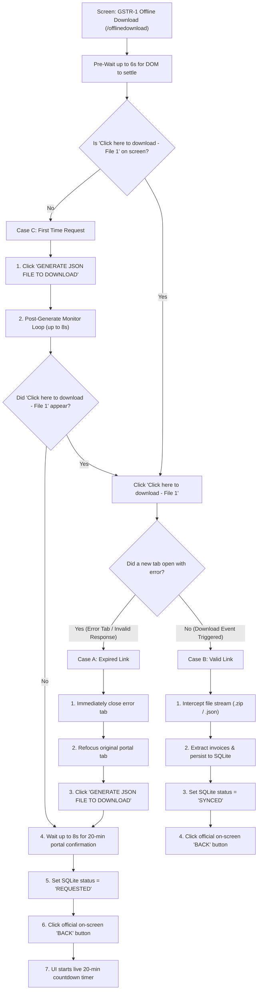

# GSTR-1 Autopilot — Dedicated Architecture & Granular Memory Manual

> **Module Identity:** GSTR-1 Outward Supplies Auto Downloader & Full-Year Consolidator  
> **Source Files:**
> - Core Autopilot: `gstr1/autopilot.js` (Lines 1–2207)
> - Database Layer: `gstr1/db.js`
> - Parsers (JSON, Excel, ZIP): `gstr1/parsers.js`
> - Full Year Excel: `gstr1/fullYearExcel.js`
> - API Routes: `gstr1_routes.js`
> - Autopilot Config: `gstr1/autopilot_config.json`

---

## 1. Exact Line-by-Line Code Map (`gstr1/autopilot.js`)

| Line Range | Function / Phase | Kya Karta Hai | Kaise Karta Hai |
|---|---|---|---|
| **Lines 430–488** | `ensureReturnsSearchScreen()` | Guarantees browser is on Returns Dashboard | Detects URL, clicks in-page Return Dashboard tiles, verifies `>= 2` select dropdowns. |
| **Lines 493–650** | `selectPeriodAndSearch()` | Period selection & AJAX search synchronization | Selects FY, Quarter, Month via Angular `$apply()`, clicks `SEARCH`, waits for `.loading, .spinner, [ng-show*="loading"]` to hide. |
| **Lines 653–835** | `downloadAndProcessGstr1()` — **Step 5** | Identifies GSTR-1 tile & clicks offline/download | Title-down search matching `OUTWARD SUPPLIES` or `GSTR-1` (excluding 3B/2B). Targets `PREPARE OFFLINE` (unfiled) or `DOWNLOAD` (filed). Verifies landing on `/offline` or `/offlinedownload`. |
| **Lines 837–985** | `downloadAndProcessGstr1()` — **Step 6** | Verifies Download screen state | If already on `/offlinedownload`, proceeds directly. If on `/offline`, switches to in-page `#download` tab. |
| **Lines 988–1310** | `downloadAndProcessGstr1()` — **Step 7** | Dynamic 3-Case Link Discovery & Request Generation | Pre-waits up to 6s for Angular DOM to settle. Checks for `Click here to download - File 1`. If present, tests validity (Case A error tab vs Case B download). If missing/expired, clicks `GENERATE JSON FILE TO DOWNLOAD` and executes Post-Generate monitor loop (up to 8s) to test and click newly ready download link. |
| **Lines 1312–1395** | `downloadAndProcessGstr1()` — **Case B** | Valid link download & persistence | Captures file stream, parses `.json`/`.zip`, saves line-items to `gstr1_invoices`, marks batch `SYNCED`, clicks official on-screen `BACK` button. |
| **Lines 1397–1440** | `downloadAndProcessGstr1()` — **Case C / Requested** | 20-Minute Queue Handling | Clicks `GENERATE JSON FILE TO DOWNLOAD`, confirms 20-min wait message, marks `REQUESTED`, clicks official on-screen `BACK` button. |

---

## 2. Step 7: Dynamic 3-Case Execution Logic (Detailed Flow)

---

## 3. Critical Rules for GSTR-1 Autopilot

1. **NO EXCLUDING CONTENT HEADERS VIA `.header`:** Only top navigation elements (`header, nav, .navbar, footer, #navbar, #navbar-usr-menu, .navbar-nav`) are excluded when locating download links. Generic class `.header` must NEVER be excluded, as portal content containers use header classes.
2. **BROAD ELEMENT SELECTION FOR DOWNLOAD LINK:** Queries `a, span, button, [role='link'], p, div` with regex `/Click\s*here\s*to\s*download|File\s*1/i` to ensure Angular compiled elements are never missed.
3. **POST-GENERATE DETECTION GUARANTEE:** After clicking `GENERATE JSON FILE TO DOWNLOAD`, the script runs a polling loop (up to 8s) that tests and clicks `Click here to download - File 1` if it is present or becomes ready.
4. **NO RE-CLICKING CONFIRMED EXPIRED LINKS:** Once a link is confirmed expired via error tab in the current cycle, the script will not re-click it.
5. **OFFICIAL ON-SCREEN BACK BUTTON:** Always targets official button (`button:has-text('BACK'), input[value='BACK' i]`), strictly ignoring breadcrumbs, anchor tags, or top navigation.
