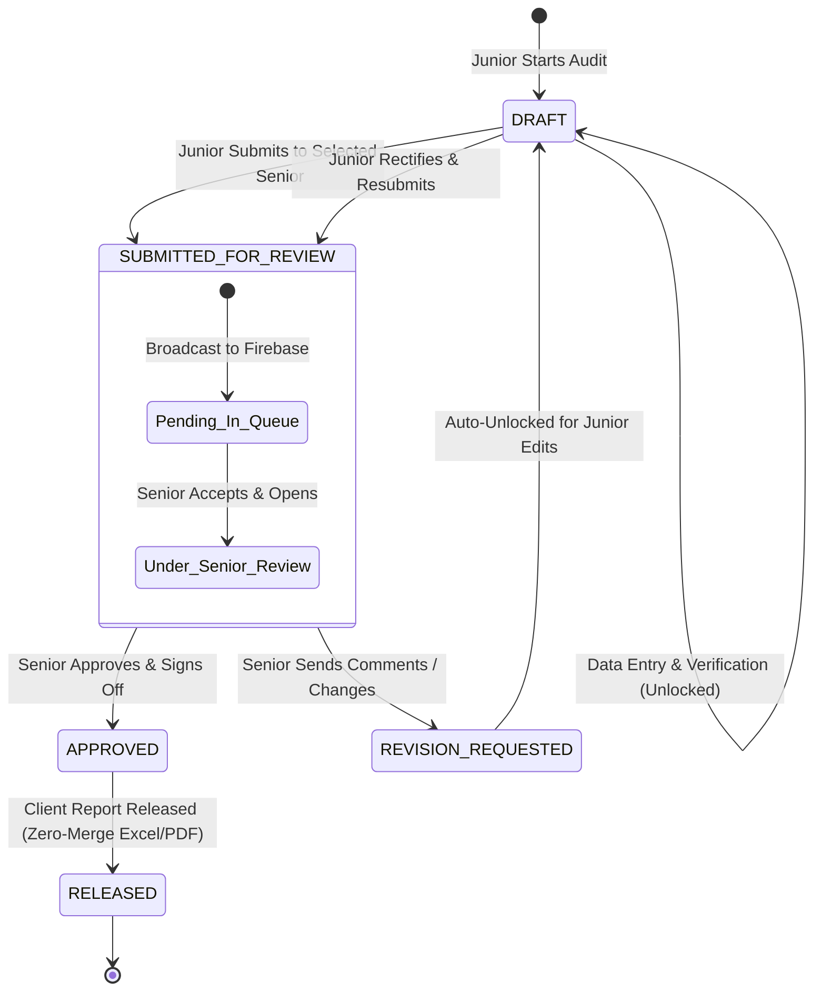

# Phase 30 Context: Monthly Audit Multi-User Maker-Checker Review & Approval Workflow (Senior/Junior Firebase Collaboration)

## 1. Executive Summary & Intent
Phase 30 delivers an enterprise-grade multi-user Maker-Checker review, scrutiny, and sign-off pipeline for **Suite 08 (Monthly Audit Format & Working Paper Verification Suite)**, integrating Firebase Firestore real-time synchronization between Junior Article Assistants and Senior CA Partners.

When junior auditors and senior auditors are provisioned in Firebase (`network_users` collection), this workflow enables:
1. **Dynamic Senior Selection**: Junior selects from cloud-synced Senior Partners/Managers when submitting an audit.
2. **Real-Time Review Broadcast**: Submitting instantly pushes working paper metadata and metrics to Firebase Firestore and locks the draft for junior edits.
3. **Senior Review Requests Hub (Inbox)**: Senior CA Partners see a real-time notification badge and inbox of all audits submitted to them across all clients, with 1-click "Accept & Review" routing.
4. **Structured Review Scrutiny & Commenting**:
   - If correct: Senior clicks **"Approve & Sign-Off"**, stamping digital sign-off into SQLite, Firestore, and client-facing Zero-Merge Excel/PDF reports.
   - If changes needed: Senior clicks **"Request Revision"**, entering structured, section-specific change comments and queries.
5. **Auto-Unlock & Resubmission Loop**: Junior receives instant real-time notification, the working papers automatically unlock with the senior's comments prominently displayed, junior rectifies the points, and resubmits to senior.

---

## 2. Maker-Checker State Machine & Lifecycle

---

## 3. Detailed Component Mechanics

### A. Role Detection & User Context
- Firebase Firestore collection: `network_users`
- Schema:
  - `username`: Unique ID/email
  - `name`: Display Name (e.g., "CA Ramesh Vaswani")
  - `role`: `'junior'` | `'senior'` | `'partner'` | `'manager'` | `'admin'`
  - `designation`: e.g., "Senior Partner, CA", "Article Assistant"
  - `is_active`: 1
- App Behavior:
  - On login / session initialization, `currentRole` defaults automatically based on user's role.
  - Senior Partners have the authority to switch to Junior view for auditing or data review.

### B. Junior Workflow: Prepare, Select Senior & Submit
1. Junior completes vouching across 5 sections (Basic Details, Profitability, Core 5 Registers, Compliances & Observations, Pending Points).
2. Junior clicks **"Submit for Senior Review"**.
3. Modal displays:
   - Senior Dropdown: Auto-populated via `fetchSeniorAuditorsFromCloud()`.
   - Prepared By: Pre-filled with Junior name.
   - Urgency Priority: `Normal` | `High` | `Urgent (GST Deadline)`.
   - Handover Notes: Summary of verifications and specific attention areas.
4. Submission:
   - SQLite update: `audit_status = 'SUBMITTED_FOR_REVIEW'`, `status = 'Under Review'`.
   - Firebase Firestore: `submitAuditForSeniorReviewInFirebase(...)` writes to `monthly_audits` collection.
   - **Locking**: `canJuniorEdit` evaluates to `false`. Working papers become read-only.
   - Banner: Displays blue pending banner.

### C. Senior Workflow: Inbox, Accept & Review
1. Header displays **"Pending Reviews (N)"** badge powered by `subscribeToSeniorPendingQueue`.
2. Senior clicks the badge to open **"Senior Review Requests Hub"** drawer.
3. Card shows client details, period, junior article name, urgency, handover notes, and observation counters.
4. Senior clicks **"Accept & Review"**:
   - Automatically switches active client, FY, and month.
   - Sets review status and displays Amber Review Banner.

### D. Senior Scrutiny & Sign-Off Actions
1. **Action 1: Approve & Sign-Off**
   - Click "Approve & Sign-Off" ➔ Enters optional partner sign-off note.
   - Updates SQLite: `audit_status = 'APPROVED'`, `reviewed_by`, `reviewed_at`.
   - Updates Firebase: `approveAuditInFirebase(...)`.
   - Junior's screen updates in real time to green "Approved" badge.
   - Unlocks "Release Report to Client" (generating official Zero-Merge Excel & PDF).
2. **Action 2: Request Revision (Send Comments for Changes)**
   - Click "Request Revision" ➔ Opens Structured Revision Modal.
   - Senior enters categorized change comments (e.g. Sales Reco, Purchase 2B, Cash 40A(3), Observations).
   - Updates SQLite: `audit_status = 'REVISION_REQUESTED'`, `senior_review_notes`.
   - Updates Firebase: `requestRevisionInFirebase(...)`.
   - Junior's screen updates in real time to Rose alert banner with exact comments.
   - Working papers **automatically unlock** for Junior edits.
   - Junior addresses comments and resubmits.

---

## 4. Technical Files & Cross-References
- UI Component: `src/pages/MonthlyAuditSuite.tsx`
- Cloud Sync Engine: `src/lib/firebaseAuditSync.ts`
- Backend REST API: `monthly_audit_routes.js`
- Core Data Models: `src/lib/monthlyAuditEngine.ts`
- Excel & PDF Exporters: `src/lib/monthlyAuditExcel.ts`, `src/lib/monthlyAuditPdf.ts`
- Test Suites: `src/test/firebaseAuditSync.test.ts`, `src/test/monthlyAuditSuitePeriodAndTeam.test.ts`
