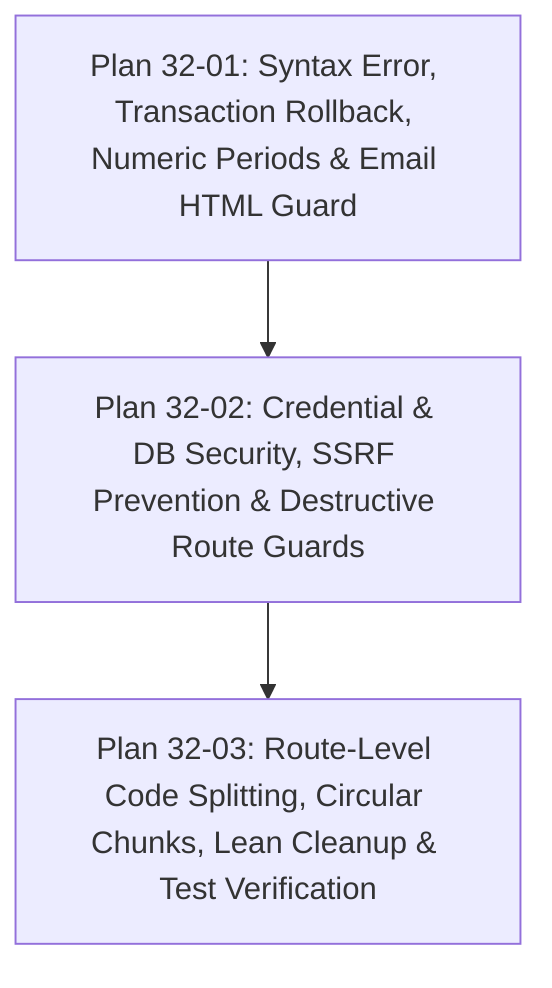

# Phase 32 Context: Codebase Audit Remediation: Syntax, Database Security, SSRF Prevention & Lean Optimization

**Phase:** 32 — Codebase Audit Remediation: Syntax, Database Security, SSRF Prevention & Lean Optimization  
**Milestone:** Vaswani Return Enterprise (Audit With Vaswani)  
**Status:** In Planning  

---

## 1. Locked Decisions & Architectural Contracts

### D-32-01: Zero-Syntax-Error & 100% Vitest Pass Contract
- **Decision:** All async calls inside route handlers and callbacks must use valid `async/await` syntax.
- **Contract:** `monthly_audit_routes.js:L454` must declare `async (err, audit) =>` before calling `await resolveMonthlyAuditFolder(...)`. The failing backend test suite `src/test/monthlyAuditBackend.test.ts` must pass completely.

### D-32-02: Privacy & Credential Security Invariant
- **Decision:** Production client credentials and user passwords must never be tracked in git or pre-bundled into distributed installer executables.
- **Contract:** `network_data.db` and `network_data.db.bak` must be untracked from Git and removed from `package.json` installer `extraResources`. `network_users.json` with unhashed passwords must be removed from Git and gitignored. All user authentication must use bcrypt hashes in SQLite `network_users`. On fresh installs, server must generate or initialize clean schema tables.

### D-32-03: Zero-Data-Loss Transaction Rollback
- **Decision:** Any bulk invoice database ingestion must guarantee atomic all-or-nothing persistence.
- **Contract:** `bulkSaveGstr2bInvoices` in `gstr2b/db.js` must monitor statement execution errors in `stmt.run`. If any insertion fails, it must issue `db.run('ROLLBACK')` and reject, preventing silent loss of previously existing monthly invoices.

### D-32-04: SSRF & Destructive Endpoint Authentication
- **Decision:** Every administrative, destructive, or proxy endpoint must require valid authentication.
- **Contract:**
  - `POST /api/tds/reset` must be wrapped with `authenticateToken`, restricted to admin role, and require confirmation payload.
  - `POST /api/tally-proxy` must be protected with `authenticateToken` and constrain the port to allowed Tally ranges (9000-9010).
  - `POST /api/returns/open-folder` must require `authenticateToken` and validate that folder paths resolve inside authorized directories.

### D-32-05: Route-Level Code Splitting & Circular Dependency Elimination
- **Decision:** Split the monolithic 7.1 MB JavaScript bundle into on-demand route chunks.
- **Contract:** Convert heavy pages (`IncomeTaxDashboard`, `GstNoticesDashboard`, `MonthlyAuditSuite`, `Reconciliation`, `BankCmaAppraisal`) in `src/App.tsx` to `React.lazy()` with `<React.Suspense>`. Clean up `vite.config.ts` manual chunks to eliminate the circular reference warning between `@radix-ui` and `@tanstack`.

### D-32-06: Lean Dependency & Output Hygiene
- **Decision:** Eliminate duplicate libraries and redundant lockfiles.
- **Contract:** Remove `react-hot-toast` and `framer-motion` in favor of `sonner` and `motion`. Remove redundant `bun.lock` and `bun.lockb`.

---

## 2. Plan Breakdown & Dependency Graph

- **Plan 32-01:** Fixes the callback syntax bug in `monthly_audit_routes.js`, adds transaction rollback to `bulkSaveGstr2bInvoices`, parses 6-digit numeric return periods in GSTR-1 full-year exporter, and escapes HTML notes in outgoing client emails.
- **Plan 32-02:** Untracks live database and user files from Git, removes them from electron-builder extraResources, hardens `tds_routes.js` reset route, constrains Tally proxy port to prevent SSRF, and guards folder opening.
- **Plan 32-03:** Refactors `App.tsx` routes with `React.lazy`, fixes `vite.config.ts` manualChunks, cleans duplicate npm packages, batches network scans in `main.cjs`, and verifies with 100% green Vitest and production build.
