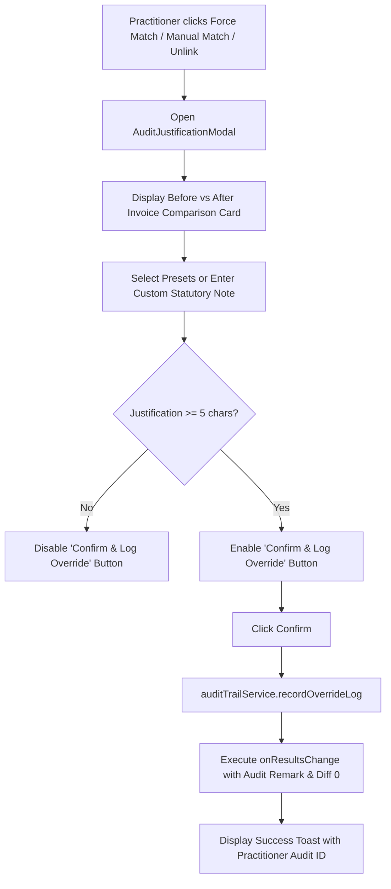
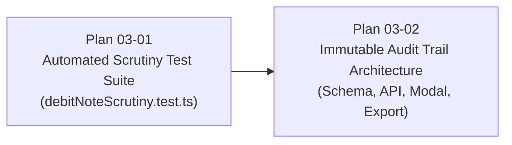

# Phase 3: Automated Scrutiny Tests & Audit Trail Hardening — Technical Research

**Phase:** Phase 3 — Automated Scrutiny Tests & Audit Trail Hardening  
**Target Directory:** `.planning/phases/03-automated-scrutiny-tests-audit-trail-hardening/`  
**Status:** Complete  
**Date:** 2026-10-22  
**Requirement References:** `AUDIT-01`, `DN-01` through `DN-05`, `CORE-01`, `CORE-02`

---

## 1. Executive Summary

Phase 3 establishes statutory audit-grade integrity and rigorous verification across the Vaswani Return Enterprise suite. It accomplishes two foundational objectives:

1. **Comprehensive Scrutiny Test Suite (`03-01`)**:
   Constructs `src/test/debitNoteScrutiny.test.ts` to complement `src/test/debitNoteEngine.test.ts`. This suite subjects the 6-pass debit note engine (`src/lib/debitNoteEngine.ts`) and bounded subset-sum batch solver to combinatorial edge cases ($2 \le |S| \le 15$), tolerance boundary thresholds (₹25 value, ₹15 tax), multi-prefix stripping, generic voucher token variations, and an extreme 50+ batch zero double-counting accounting invariant validation ($\sum \text{Reconciled} = \sum \text{Raw Input}$).

2. **Immutable Audit Trail Persistence & Hardening (`03-02`)**:
   Fulfills requirement `AUDIT-01` by replacing silent, instant status mutations in `src/components/PartyWiseReport.tsx` and `src/components/ResultsTable.tsx` with a statutory practitioner justification workflow. It introduces:
   - A dedicated SQLite table `reconciliation_audit_log` in `network_data.db` managed via `audit_trail_routes.js` and mounted in `server.js`.
   - Validated REST API endpoints (`POST`, `GET`, `GET /export`).
   - Offline-resilient local queuing via `src/lib/auditTrailService.ts`.
   - An interactive, accessible `src/components/AuditJustificationModal.tsx` with statutory justification presets.
   - Excel export integration in `src/lib/excel/builders/masterExport.ts` and `partyWiseExport.ts` adhering strictly to the Zero-Merge architecture (`ws['!merges'] = []`).

```mermaid
flowchart TD
    subgraph UI ["Frontend User Experience"]
        PWR["PartyWiseReport.tsx / ResultsTable.tsx"]
        AJM["AuditJustificationModal.tsx<br/>(Before/After Diffs + Presets)"]
        ATS["auditTrailService.ts<br/>(Offline Queue + Sync Engine)"]
        PWR -->|User triggers Force/Manual Match/Unlink| AJM
        AJM -->|Valid justification (>= 5 chars)| ATS
    end

    subgraph Storage ["Hybrid Storage Layer"]
        LS["localStorage Pending Queue<br/>(Offline Resilience)"]
        API["Express API Server<br/>(audit_trail_routes.js)"]
        SQL["SQLite Database<br/>(network_data.db: reconciliation_audit_log)"]
        ATS -->|Save local queue| LS
        ATS -->|POST /api/audit/reconciliation-override| API
        API -->|Insert immutable record| SQL
    end

    subgraph Export ["Export & Verification"]
        MEX["masterExport.ts & partyWiseExport.ts"]
        ZMG["zeroMergeGuard.ts (ws['!merges'] = [])"]
        XLS["Analytical Audit Workbook (.xlsx)"]
        SQL -->|Fetch audit records| MEX
        MEX --> ZMG --> XLS
    end
```

---

## 2. Core Architecture Analysis

### 2.1 Debit Note Engine & Subset-Sum Solver

The dynamic reconciliation engine resides in [`src/lib/debitNoteEngine.ts`](file:///D:/My%20software/full%20and%20final/gst%20consolidater/reco-with-vaswani-main/src/lib/debitNoteEngine.ts). When dealing with dynamic taxpayer datasets (non-benchmark), it executes `runDynamicSevenPassReconciliation`:

| Pass | Target Concept | Key Logic & Matching Invariants |
| :--- | :--- | :--- |
| **Pass 1** | 1-to-1 Exact & Normalized Invoice No | Matches normalized invoice numbers (`normalizeInvoiceNo`) under effective supplier GSTIN (`resolveEffectiveGstin`). Contains the **Composite Batch Guardrail**: if PR value is significantly larger than 2B note value ($> \text{val}_{2B} + 10.00$), checks if PR represents a lump-sum combining multiple notes; if so, defers to Pass 3. |
| **Pass 2** | 1-to-1 Value Match (Generic DN) | If PR voucher is a generic token (`isGenericDn`: `DN`, `CN`, `DEBITNOTE`, `BLANK`), matches by amount within ₹10 taxable and ₹2 tax tolerance. In case of multiple candidates, picks the closest date to `targetDate`. |
| **Pass 3** | 1-to-Many Consolidated Batch Solver | Resolves 1 PR lump-sum against multiple 2B credit notes using `findSubsetSumMatch`. First tries natural date clusters (Tier 3A), then bounded combinatorial subset-sum search (Tier 3B). Formats lead row + grouped sub-rows with ₹0 PR values to maintain zero double-counting. |
| **Pass 4** | 1-to-1 Partial Value Match | Matches records by supplier proximity within 5% value variance and 30-day date window. Flags as `'Partially Matched (Value Diff)'`. |
| **Pass 5** | Unmatched 2B Credit Notes | Flags remaining 2B credit notes as `'In 2B Credit Notes Only (Not in Books)'`. Recommends ITC reversal investigation. |
| **Pass 6** | 2B Supplier Debit Notes | Flags remaining 2B debit notes as `'In 2B Supplier Debit Notes (ITC Claimable)'`. Eligible ITC increase. |
| **Pass 7** | Unmatched Books Rows | Separates non-zero rows (`'In Books Only - Taxable (Not in 2B)'`) from zero-tax/nil-rated rows (`'In Books Only - Nil-Rated Seed (Exempt)'`). |

#### Subset-Sum Algorithm Mechanics
In `findSubsetSumMatch` ([`src/lib/debitNoteEngine.ts#L452-L553`](file:///D:/My%20software/full%20and%20final/gst%20consolidater/reco-with-vaswani-main/src/lib/debitNoteEngine.ts#L452-L553)):
- **Tier 3A (Natural Date Clusters)**: Evaluates candidate pools grouped by `dateStr`. If $\sum \text{group} \approx \text{target}$ within tolerance (₹25 value, ₹15 tax), returns immediately. Also checks sub-clusters grouped by the first 6 characters of `invNorm`.
- **Tier 3B (Bounded Combinatorial Search)**:
  - Candidates sorted by date proximity to target date (fallback to value).
  - Truncated to a maximum candidate pool of 30 items: `boundedPool = pool.slice(0, 30)`.
  - Iterates combination sizes $k \in [2, \min(15, \text{boundedPool.length})]$.
  - Prunes exploration branches where accumulated value exceeds target by $> ₹25.00$:
    ```typescript
    if (targetVal > 0 && nextVal > targetVal + 25.0 && nextTx > targetTx + 25.0) continue;
    ```
  - Hard cutoff: `maxTimeoutMs` (default 500ms) prevents event-loop starvation.

### 2.2 Backend SQLite & Express Architecture

The backend operates in [`server.js`](file:///D:/My%20software/full%20and%20final/gst%20consolidater/reco-with-vaswani-main/server.js) with SQLite persistence via `sqlite3`:
- Database path: `const DB_PATH = path.join(userDataPath, 'network_data.db')`.
- Data root: `const userDataPath = process.env.USER_DATA_PATH || '.'`.
- Modular routing pattern: `setupTdsRoutes(app, db)`, `setupTaxRoutes(app, db)`, `setupReturnsStorageRoutes(app, db, userDataPath)`.
- Authentication: `authenticateToken` middleware verifies JWT header `Authorization: Bearer <token>`.
- Client-side token retrieval: [`src/lib/api.ts`](file:///D:/My%20software/full%20and%20final/gst%20consolidater/reco-with-vaswani-main/src/lib/api.ts) provides `getToken()`, `authHeaders()`, `apiGet()`, and `apiPost()`.
- Active practitioner identity: `localStorage.getItem('np_user')` or `sessionStorage.getItem('np_user')`.

---

## 3. Scrutiny Testing Deep-Dive (Plan 03-01)

### 3.1 Gap Analysis: `debitNoteEngine.test.ts` vs `debitNoteScrutiny.test.ts`

While [`src/test/debitNoteEngine.test.ts`](file:///D:/My%20software/full%20and%20final/gst%20consolidater/reco-with-vaswani-main/src/test/debitNoteEngine.test.ts) validates baseline happy paths and 4-record mock sets, it lacks rigorous combinatorial stress testing and boundary condition proofs:

| Test Domain | Existing Coverage (`debitNoteEngine.test.ts`) | Required Scrutiny Suite (`debitNoteScrutiny.test.ts`) |
| :--- | :--- | :--- |
| **Subset-Sum $|S|$ Range** | Single 2-note batch and 3-note batch | Systematic verification of $k \in \{2, 3, 5, 8, 10, 12, 15\}$, plus $k > 15$ cap assertion. |
| **Decoy Candidate Resistance** | No noise candidates; pool only contains matching notes | Candidate pool contains 10 to 15 extraneous non-matching notes of similar value and dates. |
| **Tolerance Boundaries** | Only tested with 0 diff or minor rounding | Exact mathematical boundaries: ₹24.99 (match), ₹25.00 (match), ₹25.01 (fail); ₹14.99 tax (match), ₹15.00 tax (match), ₹15.01 tax (fail). |
| **Prefix Cleaning** | Basic `MH-2526/` and `MH/25-26/` | Multi-state prefixes, slash/dash/FY combinations, leading zeros (`000123`), whitespace permutations, empty/null inputs. |
| **Generic Voucher Tokens** | Exact string literals (`DN`, `CN`, `BLANK`) | Casing (`dn`, `Cn`), spaced (`d n`), hyphenated (`DN-BLANK`), and anti-patterns (`DN-01`, `CN999`) to prevent false positives. |
| **Zero Double-Counting Invariant** | 4-row minimal fixture | Synthetic generator executing 50 multi-note batches + 50 single/unmatched rows (>250 total rows). Strict delta $< 0.01$ check across all 10 monetary columns. |

### 3.2 Combinatorial & Boundary Test Specifications

#### Test Suite 1: Bounded Subset-Sum Combinations ($|S| \in [2, 15]$) with Decoys
```typescript
interface InternalItem {
  id: number;
  raw: any;
  val: number;
  taxable: number;
  cgst: number;
  sgst: number;
  igst: number;
  taxTot: number;
  invNorm: string;
  dateObj: Date | null;
  dateStr: string;
  gstin: string;
  effGstin: string;
  suppName: string;
  suppNorm: string;
  voucherNo: string;
  period: string;
  noteType: string;
}
```
- **Test Matrix**:
  1. **$k=2$ with 8 decoys**: Target ₹100,000. Matching: [₹60,000, ₹40,000]. Decoys: 8 notes of ₹35k, ₹45k, ₹55k, ₹70k.
  2. **$k=3$ with 10 decoys**: Target ₹150,000. Matching: [₹50,000, ₹70,000, ₹30,000]. Decoys: 10 random notes.
  3. **$k=5$ with 10 decoys**: Target ₹250,000. Matching: [₹50k, ₹50k, ₹50k, ₹50k, ₹50k]. Decoys: 10 distinct notes.
  4. **$k=8$ with 12 decoys**: Target ₹160,000. Matching: 8 notes of ₹20,000 each.
  5. **$k=12$ with 10 decoys**: Target ₹120,000. Matching: 12 notes of ₹10,000 each.
  6. **$k=15$ with 10 decoys**: Target ₹150,000. Matching: 15 notes of ₹10,000 each (pool size 25 $\le$ 30).
  7. **$k=16$ overflow guardrail**: Target ₹160,000 composed of 16 notes. Expect `null` (since search depth is bounded to 15) without hanging or exceeding the 500ms timeout budget.
  8. **Pool truncation ($>30$ candidates)**: Pool of 40 candidates. Verifies that `boundedPool.slice(0, 30)` handles execution without error and completes in $< 500\text{ms}$.

#### Test Suite 2: Tolerance Limits & Boundary Thresholds
- **Value Tolerances**:
  - $\Delta \text{Val} = +₹24.99$, $\Delta \text{Tax} = +₹5.00$ $\rightarrow$ **MATCH**.
  - $\Delta \text{Val} = +₹25.00$, $\Delta \text{Tax} = +₹10.00$ $\rightarrow$ **MATCH**.
  - $\Delta \text{Val} = +₹25.01$, $\Delta \text{Tax} = +₹5.00$ $\rightarrow$ **FAIL (null)**.
- **Tax Tolerances**:
  - $\Delta \text{Val} = +₹10.00$, $\Delta \text{Tax} = +₹14.99$ $\rightarrow$ **MATCH**.
  - $\Delta \text{Val} = +₹10.00$, $\Delta \text{Tax} = +₹15.00$ $\rightarrow$ **MATCH**.
  - $\Delta \text{Val} = +₹10.00$, $\Delta \text{Tax} = +₹15.01$ $\rightarrow$ **FAIL (null)**.
- **Negative Tolerances (Sum exceeds target)**:
  - $\sum \text{Notes} - \text{Target} = ₹24.95$ $\rightarrow$ **MATCH**.
  - $\sum \text{Notes} - \text{Target} = ₹25.05$ $\rightarrow$ **FAIL (null)**.
- **Pass 1 Waterfall Boundaries**:
  - Exact match: $\Delta \text{Taxable} < 0.02$, $\Delta \text{Tax} < 0.02$ $\rightarrow$ `'Reconciled (Exact Match)'`.
  - Rounding diff: $\Delta \text{Taxable} \le 10.00$, $\Delta \text{Tax} \le 2.00$ $\rightarrow$ `'Reconciled (Rounding Diff)'`.
  - Value diff: $\Delta \text{Taxable} = 10.05$, $\Delta \text{Tax} = 2.05$ $\rightarrow$ `'Partially Matched (Value Diff)'`.

#### Test Suite 3: Multi-Prefix Stripping & Normalization
- Target function: `normalizeInvoiceNo(inv: any)`.
- Edge cases to prove:
  - Regional/FY prefixes:
    - `'MH-2526/1234'` $\rightarrow$ `'1234'`
    - `'MH-CN-2526-0025'` $\rightarrow$ `'0025'`
    - `'MH/25-26/044'` $\rightarrow$ `'044'`
    - `'MH2526/999'` $\rightarrow$ `'999'`
    - `'MH/2526/888'` $\rightarrow$ `'888'`
    - `'MH/25/26/777'` $\rightarrow$ `'777'`
    - `'MH-25-26/666'` $\rightarrow$ `'666'`
  - Non-prefix GST invoice patterns:
    - `'GCN-23-FY26-001'` $\rightarrow$ `'GCN/23/FY26/001'` (hyphens to slashes)
    - `'INV-2024-99'` $\rightarrow$ `'INV/2024/99'`
  - Whitespace & casing:
    - `'  mh / 2526 / 1234  '` $\rightarrow$ `'1234'`
  - Zero-padding preservation:
    - `'MH-2526/000123'` $\rightarrow$ `'000123'` (does not strip numerical leading zeros)
  - Null, undefined, empty, number:
    - `null` $\rightarrow$ `''`
    - `undefined` $\rightarrow$ `''`
    - `12345` $\rightarrow$ `'12345'`

#### Test Suite 4: Generic Token Permutations & False-Positive Guardrails
- Target function: `isGenericDn(invNorm: string)`.
- True generic tokens:
  - `''`, `'-'`, `'--'`, `'DN'`, `'dn'`, `'Dn'`, `'CN'`, `'cn'`, `'Cn'`, `'DEBITNOTE'`, `'Debit Note'`, `'Debit-Note'`, `'CREDITNOTE'`, `'Credit Note'`, `'BLANK'`, `'blank'`, `'DN(BLANK)'`, `'DN-BLANK'`, `'DN/BLANK'`, `'DNBLANK'`.
- False-positive guardrails (must return `false`):
  - Specific note IDs: `'DN-01'`, `'DN/001'`, `'DN123'`, `'CN-999'`, `'CN2025'`, `'INVOICE-01'`, `'BILL-9015006303'`, `'GCN/23/FY26/001'`.

#### Test Suite 5: Zero Double-Counting Mathematical Invariant (50+ Batches)
- Construct synthetic dataset:
  - 50 batches of multi-note debit adjustments (1 PR note $\leftrightarrow$ 2 to 5 2B notes).
  - 25 1-to-1 exact matches.
  - 15 generic DN voucher matches.
  - 10 unmatched taxable PR notes.
  - 5 unmatched nil-rated exempt seed PR notes.
  - 15 unmatched 2B credit notes.
  - 8 2B supplier debit notes.
  - Total records $> 250$ across 15 distinct suppliers.
- Strict assertions:
  $$\left|\sum \text{Reconciled Rows Taxable PR} - \sum \text{Raw Input Taxable PR}\right| < 0.01$$
  $$\left|\sum \text{Reconciled Rows CGST PR} - \sum \text{Raw Input CGST PR}\right| < 0.01$$
  $$\left|\sum \text{Reconciled Rows SGST PR} - \sum \text{Raw Input SGST PR}\right| < 0.01$$
  $$\left|\sum \text{Reconciled Rows IGST PR} - \sum \text{Raw Input IGST PR}\right| < 0.01$$
  $$\left|\sum \text{Reconciled Rows Val PR} - \sum \text{Raw Input Val PR}\right| < 0.01$$
  (and equivalent 5 assertions for 2B numeric columns).
- Sub-row verification:
  For every row where `isSubRow === true`:
  `taxableValuePR === 0 && cgstPR === 0 && sgstPR === 0 && igstPR === 0 && invoiceValuePR === 0`.

---

## 4. Immutable Audit Trail Architecture (Plan 03-02)

### 4.1 SQLite Schema & Migration Strategy

To support requirement `AUDIT-01`, a persistent table must be created in `network_data.db`.

```sql
CREATE TABLE IF NOT EXISTS reconciliation_audit_log (
  id TEXT PRIMARY KEY,
  timestamp INTEGER NOT NULL,
  iso_timestamp TEXT NOT NULL,
  practitioner_username TEXT NOT NULL,
  client_gstin TEXT,
  company_name TEXT,
  action_type TEXT NOT NULL, -- 'FORCE_MATCH' | 'MANUAL_MATCH' | 'BATCH_MATCH' | 'UNLINK' | 'AUTO_MATCH_PARTY'
  invoice_no_pr TEXT,
  invoice_no_2b TEXT,
  original_status TEXT,
  new_status TEXT NOT NULL,
  taxable_diff REAL,
  gst_diff REAL,
  justification TEXT NOT NULL,
  metadata TEXT -- JSON string with before/after state snapshots
);

CREATE INDEX IF NOT EXISTS idx_audit_timestamp ON reconciliation_audit_log (timestamp DESC);
CREATE INDEX IF NOT EXISTS idx_audit_gstin ON reconciliation_audit_log (client_gstin);
CREATE INDEX IF NOT EXISTS idx_audit_company ON reconciliation_audit_log (company_name);
```

#### TypeScript Types (`src/lib/auditTrailService.ts`)
```typescript
export type AuditActionType =
  | 'FORCE_MATCH'
  | 'MANUAL_MATCH'
  | 'BATCH_MATCH'
  | 'UNLINK'
  | 'AUTO_MATCH_PARTY';

export interface AuditOverrideRecord {
  id: string;
  timestamp: number;
  iso_timestamp: string;
  practitioner_username: string;
  client_gstin?: string;
  company_name?: string;
  action_type: AuditActionType;
  invoice_no_pr?: string;
  invoice_no_2b?: string;
  original_status?: string;
  new_status: string;
  taxable_diff?: number;
  gst_diff?: number;
  justification: string;
  metadata?: string; // JSON serialized snapshot
  is_synced?: boolean;
}

export interface AuditOverrideInput {
  action_type: AuditActionType;
  practitioner_username?: string;
  client_gstin?: string;
  company_name?: string;
  invoice_no_pr?: string;
  invoice_no_2b?: string;
  original_status?: string;
  new_status: string;
  taxable_diff?: number;
  gst_diff?: number;
  justification: string;
  metadata?: Record<string, any>;
}
```

### 4.2 Modular Backend Route Integration (`audit_trail_routes.js`)

In accordance with the architecture of `returns_storage_routes.js` and `tds_routes.js`, all audit persistence logic will be encapsulated in `audit_trail_routes.js` and mounted in `server.js`:

```javascript
// server.js
import setupAuditTrailRoutes from './audit_trail_routes.js';
...
setupAuditTrailRoutes(app, db, userDataPath);
```

#### API Endpoints Contract

1. `POST /api/audit/reconciliation-override`:
   - **Request Headers**: `Authorization: Bearer <token>` (optional fallback for local desktop).
   - **Request Body**: `AuditOverrideInput`.
   - **Validation Rules**:
     - `action_type` must be one of `['FORCE_MATCH', 'MANUAL_MATCH', 'BATCH_MATCH', 'UNLINK', 'AUTO_MATCH_PARTY']`. Otherwise `400 Bad Request`.
     - `justification` must be a non-empty string with `trim().length >= 5`. Otherwise `400 Bad Request` (`"Statutory justification requires minimum 5 characters"`).
     - `new_status` must be non-empty string.
     - `practitioner_username`: extracted from `req.user?.username` if token present; else from `req.body.practitioner_username` or `'Local Practitioner'`.
     - `timestamp`: server assigns `Date.now()` if absent; `iso_timestamp`: `new Date().toISOString()`.
   - **Response**: `201 Created` with `{ success: true, id, record }`.

2. `GET /api/audit/reconciliation-override`:
   - **Query Parameters**:
     - `company_name`: string (optional filter).
     - `client_gstin`: string (optional filter).
     - `action_type`: string (optional filter).
     - `limit`: number (default 500, max 2000).
     - `offset`: number (default 0).
   - **Response**: `200 OK` with `AuditOverrideRecord[]`.

3. `GET /api/audit/reconciliation-override/export`:
   - Formats audit records for spreadsheet download with standard human-readable headers:
     `['Audit ID', 'Timestamp (ISO)', 'Practitioner', 'Action', 'Company', 'GSTIN', 'Invoice No (PR)', 'Invoice No (2B)', 'Original Status', 'New Status', 'Taxable Diff', 'GST Diff', 'Statutory Justification']`.

### 4.3 Offline Resilience & Client-Side Sync (`auditTrailService.ts`)

For practitioners operating in offline or isolated desktop environments (where `server.js` may not be reachable or network calls fail):
- **Local Cache Key**: `np_audit_override_queue` stored in `localStorage`.
- **Flow**:
  1. Practitioner confirms override in `AuditJustificationModal`.
  2. `recordOverrideLog(input)` generates a local UUID and appends the entry to `np_audit_override_queue` with `is_synced: false`.
  3. Dispatches async `apiPost('/api/audit/reconciliation-override', entry)`:
     - If successful: updates local entry `is_synced: true`.
     - If failed (network error, timeout, server down): remains `is_synced: false` in queue.
  4. `syncPendingAuditLogs()` automatically drains the queue whenever:
     - App starts up.
     - `window.addEventListener('online')` fires.
     - A periodic sync interval triggers.
  5. `getOverrideLogs(companyName)` retrieves remote logs, merges unsynced local logs (deduplicated by `id`), and sorts by `timestamp DESC`.

---

## 5. Practitioner UX & Justification Modal (Plan 03-02)

### 5.1 Component Design (`AuditJustificationModal.tsx`)

Currently, in [`src/components/PartyWiseReport.tsx#L209-L233`](file:///D:/My%20software/full%20and%20final/gst%20consolidater/reco-with-vaswani-main/src/components/PartyWiseReport.tsx#L209-L233), `handleForceMatch` immediately mutates:
```typescript
// CURRENT DEFICIENT IMPLEMENTATION:
const forceMatchedItem = {
  ...raw,
  status: 'Perfect Match' as MatchStatus,
  gstDiff: 0,
  taxableDiff: 0,
  remark: 'Force Matched by User', // Hardcoded, no justification, no audit record
};
```

This will be replaced with an interactive modal dialog built with `@radix-ui/react-dialog` matching the enterprise aesthetic (`dash-card`, dark mode, sky/emerald accents):



#### Statutory Justification Presets
1. `"Vendor confirmed invoice typo in GSTR-1 (Statutory correction acknowledged)"`
2. `"Rounding difference under statutory tolerance accepted by recipient (Rule 37 compliant)"`
3. `"Credit/Debit note adjusted against previous period invoice"`
4. `"Party legal name variation verified against PAN master records"`
5. `"Custom practitioner note..."` $\rightarrow$ reveals a character-counter `Textarea` enforcing $\ge 5$ characters.

#### Invoice Comparison Card Layout
- **Left Column (Books / PR)**: Invoice No, Invoice Date, Taxable Value, CGST, SGST, IGST, Total Value.
- **Right Column (Portal / 2B)**: Invoice No, Note Date, Taxable Value, CGST, SGST, IGST, Total Value.
- **Delta Box**:
  - Base Taxable Difference (₹)
  - Net GST Difference (₹)
- **Practitioner Identity Strip**:
  - Displays `Logged-in Practitioner: <username>` (from `localStorage.getItem('np_user')` or auth context).
  - Displays exact timestamp formatted with time zone.

### 5.2 Override Call Sites in the UI

1. [`src/components/PartyWiseReport.tsx`](file:///D:/My%20software/full%20and%20final/gst%20consolidater/reco-with-vaswani-main/src/components/PartyWiseReport.tsx):
   - `handleForceMatch(invRow)`: Opens modal with `action_type = 'FORCE_MATCH'`.
   - `handleManualMatch(prInv, twoBInv)`: Opens modal with `action_type = 'MANUAL_MATCH'`.
   - `handleBatchMatch(stagedPairs)`: Prompts batch justification with `action_type = 'BATCH_MATCH'`.
   - `handleUnlinkMatch(invRow)`: Opens modal with `action_type = 'UNLINK'`.
   - `handleAutoMatchParty(party)`: Logs batch entries with `action_type = 'AUTO_MATCH_PARTY'`.
2. [`src/components/ResultsTable.tsx`](file:///D:/My%20software/full%20and%20final/gst%20consolidater/reco-with-vaswani-main/src/components/ResultsTable.tsx):
   - For rows with `status === 'Value Mismatch'` or `status === 'Mismatch'`, add a Force Match action button (`ShieldCheck` icon) that triggers `AuditJustificationModal`.

---

## 6. Zero-Merge Excel Export Integration (Plan 03-02)

### 6.1 Architectural Standards
Requirement `CORE-01` and `03-CONTEXT.md` Decision D-06 dictate:
> All generated Excel workbooks must maintain strict Zero-Merge architecture (`ws['!merges'] = []`) to guarantee sorting, filtering, and lookup formulas operate without obstruction.

### 6.2 Export Sheet Specification: `Audit Trail`

In [`src/lib/excel/builders/masterExport.ts`](file:///D:/My%20software/full%20and%20final/gst%20consolidater/reco-with-vaswani-main/src/lib/excel/builders/masterExport.ts) and [`src/lib/excel/builders/partyWiseExport.ts`](file:///D:/My%20software/full%20and%20final/gst%20consolidater/reco-with-vaswani-main/src/lib/excel/builders/partyWiseExport.ts), an optional or automatic `'Audit Trail'` tab will be appended whenever overrides exist.

#### 12-Column Specification
| Col Index | Header | Width | Data Format | Description |
| :--- | :--- | :--- | :--- | :--- |
| `A` | `Timestamp (ISO)` | 22 | Date/Text (`@`) | ISO 8601 string of override action |
| `B` | `Practitioner Username` | 20 | Text (`@`) | Username of logged-in practitioner |
| `C` | `Action Type` | 18 | Text (`@`) | `FORCE_MATCH`, `MANUAL_MATCH`, etc. |
| `D` | `Client Company` | 25 | Text (`@`) | Company / client name |
| `E` | `Counterparty GSTIN` | 18 | Text (`@`) | GSTIN of the supplier |
| `F` | `Invoice No (Books)` | 18 | Text (`@`) | PR Invoice number |
| `G` | `Invoice No (2B)` | 18 | Text (`@`) | 2B Invoice / Note number |
| `H` | `Original Status` | 18 | Text (`@`) | Status before override |
| `I` | `Overridden Status` | 18 | Text (`@`) | New status (`Perfect Match`) |
| `J` | `Taxable Diff (₹)` | 16 | Accounting (`#,##0.00;(#,##0.00);"-"`) | Base taxable difference |
| `K` | `GST Diff (₹)` | 16 | Accounting (`#,##0.00;(#,##0.00);"-"`) | Total GST difference |
| `L` | `Statutory Justification` | 45 | Text (`@`) | Mandatory practitioner explanation |

#### Zero-Merge Assertion
```typescript
ws['!merges'] = []; // Zero-Merge invariant
removeAllMergesFromWorkbook(wb);
assertZeroMerges(wb);
```

---

## 7. Plan Breakdown & File Change Matrix

### 7.1 Proposed Implementation Plans



#### Plan 03-01: Automated Scrutiny Test Suite
- **Focus**: Pure test suite covering 6-pass debit note engine, bounded subset-sum solver combinations ($|S| \in [2, 15]$), tolerance limit boundaries, prefix cleaning edge cases, and zero double-counting invariants across 50+ batches.
- **Files to create/modify**:
  - `src/test/debitNoteScrutiny.test.ts` (new)
  - `src/lib/debitNoteEngine.ts` (minor hardening if boundary tests expose edge cases)

#### Plan 03-02: Immutable Audit Trail Hardening
- **Focus**: Persistent SQLite audit logging, Express endpoints, offline-resilient local sync service, interactive practitioner justification modal, UI hookups, and zero-merge Excel export tab.
- **Files to create/modify**:
  - `audit_trail_routes.js` (new backend routes)
  - `server.js` (mount routes & initialize table)
  - `src/lib/auditTrailService.ts` (new client storage & sync service)
  - `src/components/AuditJustificationModal.tsx` (new modal component)
  - `src/components/PartyWiseReport.tsx` (hook into modal)
  - `src/components/ResultsTable.tsx` (add force-match action with modal)
  - `src/lib/excel/builders/masterExport.ts` (append audit trail sheet)
  - `src/lib/excel/builders/partyWiseExport.ts` (append audit trail sheet)
  - `src/test/auditTrail.test.ts` (new integration test suite)

### 7.2 File Modification Matrix

| File Path | Component / Layer | Action | Purpose |
| :--- | :--- | :--- | :--- |
| `src/test/debitNoteScrutiny.test.ts` | Unit / Scrutiny Testing | **Create** | 5 comprehensive scrutiny test suites ($|S| \in [2, 15]$, tolerances, prefixes, generic tokens, zero double-counting). |
| `audit_trail_routes.js` | Backend API Routes | **Create** | Implements SQLite schema setup and `POST`, `GET`, `GET /export` routes for override audits. |
| `server.js` | Express Server Core | **Modify** | Imports and registers `setupAuditTrailRoutes(app, db, userDataPath)`. |
| `src/lib/auditTrailService.ts` | Frontend Service Layer | **Create** | Manages local storage queue, network synchronization, and audit log querying. |
| `src/components/AuditJustificationModal.tsx` | UI Component | **Create** | Radix modal providing before/after comparison, statutory presets, and mandatory input validation. |
| `src/components/PartyWiseReport.tsx` | UI Counterparty View | **Modify** | Connects `handleForceMatch`, `handleManualMatch`, `handleUnlinkMatch`, and `handleBatchMatch` to modal. |
| `src/components/ResultsTable.tsx` | UI Results Table | **Modify** | Adds force-match action button to mismatch rows triggering modal. |
| `src/lib/excel/builders/masterExport.ts` | Excel Builder | **Modify** | Appends Zero-Merge `'Audit Trail'` tab when audit records exist. |
| `src/lib/excel/builders/partyWiseExport.ts` | Excel Builder | **Modify** | Appends Zero-Merge `'Audit Trail'` tab to party-wise workbook. |
| `src/test/auditTrail.test.ts` | Unit / Integration Test | **Create** | Tests audit schema validation, justification constraints ($\ge 5$ chars), offline queueing, and Excel builder. |

---

## 8. Verification Strategy & Acceptance Criteria

1. **Scrutiny Test Suite Pass Rate**:
   - Running `npx vitest run src/test/debitNoteScrutiny.test.ts` must pass 100% of tests with 0 failures.
   - Execution duration for the entire scrutiny suite must complete in $< 10$ seconds.
2. **Double-Counting Mathematical Invariant Proof**:
   - Across a synthetic 50-batch dataset ($> 250$ records), $\left|\sum \text{Reconciled} - \sum \text{Raw}\right| < 0.01$ across all 10 monetary columns for both PR and 2B registers.
3. **Audit Trail Persistence & Justification Enforcement**:
   - `POST /api/audit/reconciliation-override` rejects any submission with justification $< 5$ characters with HTTP 400.
   - Successful overrides persist to SQLite `reconciliation_audit_log` with correct practitioner username, timestamp, diffs, and before/after metadata.
   - Offline tests prove that when the backend is unreachable, overrides are held in `localStorage` and successfully synced once online.
4. **Zero-Merge Excel Compliance**:
   - Generating a master workbook with audit trail records passes `assertZeroMerges(wb)` with `ws['!merges'] = []`.
   - Running existing test `npx vitest run src/test/excelModularity.test.ts` continues to pass.

---

*Research prepared and verified for Phase 3 planning.*
