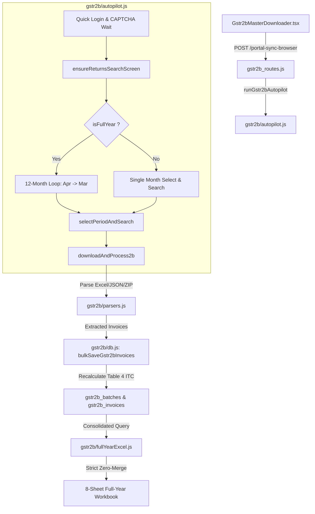
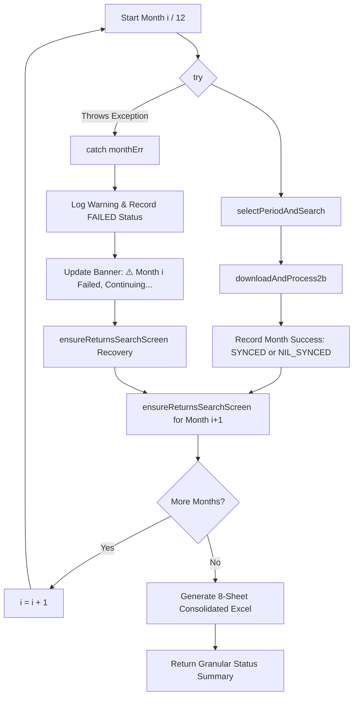

# Phase 4: GSTR-2B Downloader (Autopilot) Deep Audit & Hardening — Technical Research

**Target Phase:** Phase 4 — GSTR-2B Downloader (Autopilot) Deep Audit & Hardening  
**Target File:** `.planning/phases/04-gstr2b-downloader-autopilot-deep-audit-hardening/04-RESEARCH.md`  
**Related Documents:** [04-CONTEXT.md](file:///D:/My%20software/full%20and%20final/gst%20consolidater/reco-with-vaswani-main/.planning/phases/04-gstr2b-downloader-autopilot-deep-audit-hardening/04-CONTEXT.md), [REQUIREMENTS.md](file:///D:/My%20software/full%20and%20final/gst%20consolidater/reco-with-vaswani-main/.planning/REQUIREMENTS.md), [ROADMAP.md](file:///D:/My%20software/full%20and%20final/gst%20consolidater/reco-with-vaswani-main/.planning/ROADMAP.md)  
**Status:** Audit-Grade Complete

---

## 1. Executive Summary & Phase Scope

Tab 4 of Vaswani Return Enterprise provides **GSTR-2B Inward Supplies Automation**: a single-login Playwright autopilot that navigates the GST Portal, automates dropdown period selection, downloads official JSON/Excel files, persists line-item inward supplies into SQLite, and generates an audit-grade consolidated 8-sheet Excel workbook (`GSTR2B_SectionWiseSummary_{gstin}_{fy}.xlsx`).

### Core Objectives for Phase 4:
1. **1-Login 12-Month Loop Resilience (G2B-01):** Transform the 12-month sequential iteration in [gstr2b/autopilot.js](file:///D:/My%20software/full%20and%20final/gst%20consolidater/reco-with-vaswani-main/gstr2b/autopilot.js) into a resilient, non-blocking pipeline. If an individual month fails (portal timeout, access denied, or Angular selector delay), the engine must catch the exception, preserve existing records, log a granular warning, and continue to subsequent months (e.g., yielding "11/12 Synced").
2. **Zero-Data-Loss & Nil Return Distinction (G2B-02):** Enforce the golden rule: *"New data download nahi toh purana data remove nahi hoga"*. Never purge or truncate existing database records upon download failures or timeouts. Provide explicit detection for genuine Nil returns (portal card/download confirms 0 records) and record status as `NIL_SYNCED` with `total_invoices = 0`.
3. **Consolidated 8-Sheet SectionWiseSummary Zero-Merge Excel (G2B-03):** Verify and enforce strict zero cell merges (`ws['!merges'] = []`) across all 8 sheets in [gstr2b/fullYearExcel.js](file:///D:/My%20software/full%20and%20final/gst%20consolidater/reco-with-vaswani-main/gstr2b/fullYearExcel.js) and [src/lib/gstr2bFullYearExport.ts](file:///D:/My%20software/full%20and%20final/gst%20consolidater/reco-with-vaswani-main/src/lib/gstr2bFullYearExport.ts), maintaining side-by-side Monthly summary matrices (Cols AA–AW) and Party-wise summary matrices (Cols AZ–BV).
4. **Automated Scrutiny Vitest Test Suite (G2B-04):** Construct a comprehensive, deterministic scrutiny test suite in `src/test/gstr2bScrutiny.test.ts` validating parsers (Excel, JSON, ZIP), in-memory SQLite batch metric recalculations (`recalculate2bBatchMetrics`), zero-merge structural compliance, and non-destructive database operations.
5. **UI & Route Hardening:** Harden [src/components/Gstr2bMasterDownloader.tsx](file:///D:/My%20software/full%20and%20final/gst%20consolidater/reco-with-vaswani-main/src/components/Gstr2bMasterDownloader.tsx) and [gstr2b_routes.js](file:///D:/My%20software/full%20and%20final/gst%20consolidater/reco-with-vaswani-main/gstr2b_routes.js) with `NIL_SYNCED` badge styling, granular sync progress tooltips, and clean session aborts without orphan Chromium processes.

---

## 2. Current Architecture & Codebase Baseline

### 2.1 File Map

```
reco-with-vaswani-main/
├── gstr2b/
│   ├── autopilot.js          # Playwright autonomous loop (single month & 12M loop)
│   ├── db.js                 # SQLite schema, recalculate2bBatchMetrics, bulkSaveGstr2bInvoices
│   ├── parsers.js            # parseGstr2bExcelHelper, parseGstr2bJsonHelper, parseGstr2bZipHelper
│   └── fullYearExcel.js      # Backend 8-sheet consolidated SectionWiseSummary workbook generator
├── gstr2b_routes.js          # Express endpoints: /api/gstr2b/summary, /fy-summary, /export-full-year, /portal-sync-browser
├── src/
│   ├── components/
│   │   └── Gstr2bMasterDownloader.tsx  # Master UI: Monthly vs 12M toggle, status badges, drilldown modal
│   ├── lib/
│   │   └── gstr2bFullYearExport.ts     # Client-side 8-sheet consolidated SectionWiseSummary generator
│   └── test/
│       ├── gstr2bAutopilotScrutiny.test.ts # Existing baseline test (2 tests)
│       └── gstr2bScrutiny.test.ts          # Target comprehensive scrutiny suite
```

### 2.2 Data Flow Architecture



---

## 3. Deep Dive 1: 12-Month Loop Resilience & Non-blocking Month Progression

### 3.1 Failure Point Analysis in `gstr2b/autopilot.js`

In `gstr2b/autopilot.js` (lines 1046–1065), the 12-month loop currently runs as follows:

```javascript
for (let i = 0; i < fyMonths.length; i++) {
    if (page.isClosed()) break;
    const mInfo = fyMonths[i];
    console.log(`\n--- [GSTR-2B Full Year] Syncing Month ${i + 1}/12: ${mInfo.period} ---`);
    await updateBanner(`[Full Year 2B] Month ${i + 1}/12: Searching ${mInfo.period}...`, '#3b82f6');

    await selectPeriodAndSearch(mInfo.month, targetFy, `Month ${i + 1}/12`);
    await page.waitForTimeout(300);

    await updateBanner(`[Full Year 2B] Month ${i + 1}/12: Downloading 2B for ${mInfo.period}...`, '#10b981');
    const mRes = await downloadAndProcess2b(mInfo.period);
    syncedResults.push({ period: mInfo.period, count: mRes.count });
    total12mCount += mRes.count;

    if (i < fyMonths.length - 1) {
        await updateBanner(`[Full Year 2B] Preparing for Month ${i + 2}/12: ${fyMonths[i + 1].period}...`, '#3b82f6');
        await ensureReturnsSearchScreen();
        await page.waitForTimeout(400);
    }
}
```

#### Identified Failure Modes:
1. **Uncaught Exceptions Abort Entire Session:**
   - There is no `try / catch` inside the loop body.
   - If `selectPeriodAndSearch` throws (e.g. `page.waitForSelector('select', { timeout: 8000 })` times out due to portal latency, or Angular scope fails to trigger), the error propagates to the top-level `catch (err)` at line 1145, closing the browser immediately and returning HTTP 500.
   - A single failure in Month 3 aborts Months 4 through 12, wiping out the entire CA workflow.
2. **Access Denied or `/error/` Traps:**
   - Although `ensureReturnsSearchScreen` handles `/accessdenied/` by clicking the navbar `Dashboard` link, if `downloadAndProcess2b` or `selectPeriodAndSearch` crashes *before* `ensureReturnsSearchScreen` is reached, recovery logic is bypassed.
3. **Portal Dropdown State Machine Invalidation:**
   - When switching from Month $i$ to Month $i+1$, the Quarter select element changes options. If the Angular digest cycle has not completed, selecting the Month dropdown can select an outdated option or fail silently.
4. **Download Polling Timeout Silence:**
   - In `downloadAndProcess2b` (lines 914–1013), polling continues for 15 seconds. If no file arrives, it returns `{ count: 0, excelPath: null, jsonPath: null, metrics: null }`.
   - The loop treats this identical to a genuine Nil return, recording `{ period: mInfo.period, count: 0 }` with no indication of download failure.

### 3.2 Non-Blocking Month Progression Architecture

To achieve production-grade resilience, the month loop must be wrapped in per-month isolation with recovery guards:



#### Specification of Month Execution State:
Each month result in `syncedResults` must track:
```typescript
interface MonthSyncResult {
    period: string;
    month: string;
    status: 'SYNCED' | 'NIL_SYNCED' | 'FAILED' | 'SKIPPED';
    count: number;
    error?: string;
    excelPath?: string | null;
    jsonPath?: string | null;
}
```

#### Resilience Code Implementation Pattern:
```javascript
for (let i = 0; i < fyMonths.length; i++) {
    if (page.isClosed()) break;
    const mInfo = fyMonths[i];
    console.log(`\n--- [GSTR-2B Full Year] Syncing Month ${i + 1}/12: ${mInfo.period} ---`);
    await updateBanner(`[Full Year 2B] Month ${i + 1}/12: Searching ${mInfo.period}...`, '#3b82f6');

    try {
        await selectPeriodAndSearch(mInfo.month, targetFy, `Month ${i + 1}/12`);
        await page.waitForTimeout(400);

        await updateBanner(`[Full Year 2B] Month ${i + 1}/12: Downloading 2B for ${mInfo.period}...`, '#10b981');
        const mRes = await downloadAndProcess2b(mInfo.period);

        syncedResults.push({
            period: mInfo.period,
            month: mInfo.month,
            status: mRes.status || (mRes.count > 0 ? 'SYNCED' : 'PENDING'),
            count: mRes.count,
            excelPath: mRes.excelPath,
            jsonPath: mRes.jsonPath
        });
        total12mCount += mRes.count;
    } catch (monthErr) {
        console.error(`[GSTR-2B Full Year] ⚠️ Month ${i + 1}/12 (${mInfo.period}) failed:`, monthErr.message);
        syncedResults.push({
            period: mInfo.period,
            month: mInfo.month,
            status: 'FAILED',
            count: 0,
            error: monthErr.message
        });
        await updateBanner(`⚠️ Month ${i + 1}/12 (${mInfo.month}) failed. Retaining old data & continuing...`, '#f59e0b');
        await page.waitForTimeout(1000);
    }

    if (i < fyMonths.length - 1) {
        try {
            await updateBanner(`[Full Year 2B] Preparing for Month ${i + 2}/12: ${fyMonths[i + 1].period}...`, '#3b82f6');
            await ensureReturnsSearchScreen();
            await page.waitForTimeout(400);
        } catch (navErr) {
            console.error(`[GSTR-2B Full Year] Search screen reset error:`, navErr.message);
        }
    }
}
```

---

## 4. Deep Dive 2: Zero Data Loss & Nil Return Distinction

### 4.1 Enforcing the Golden Rule

> [!IMPORTANT]
> **The Golden Rule:** *"New data download nahi toh purana data remove nahi hoga."*
> If a download times out, portal throws `accessdenied`, network drops, or the user aborts, existing SQLite database records for that client and period must remain 100% intact.

#### Current Database Mutation Safeguards in `gstr2b/db.js`:
- In `bulkSaveGstr2bInvoices` (lines 307–400):
  ```javascript
  if (!invoices || invoices.length === 0) return resolve({ count: 0 });
  ```
  If `invoices` is empty, it returns immediately without running any `DELETE` or `UPDATE` queries. Existing invoice rows in `gstr2b_invoices` are untouched.
- Invoice ingestion uses `ON CONFLICT(client_gstin, return_period, section, ctin, inum, idt) DO UPDATE SET ...`. Existing rows from previously synced files that are not present in the new payload remain preserved.
- However, if `recalculate2bBatchMetrics` is called on a period where no invoices exist in `gstr2b_invoices`, it executes:
  ```sql
  INSERT INTO gstr2b_batches (...) VALUES (..., 'SYNCED', 0, ...)
  ON CONFLICT(client_gstin, return_period) DO UPDATE SET status = 'SYNCED', total_invoices = 0...
  ```
  This incorrectly marks an empty or un-synced month as `SYNCED`!

### 4.2 Distinguishing Nil Return vs. Failed Download

A critical distinction must be enforced between:
1. **Confirmed Nil Return (`NIL_SYNCED`):**
   - The taxpayer legitimately had 0 inward transactions for that tax period.
   - The portal card explicitly shows `0 Invoices` or `No records available`, OR the downloaded file is confirmed valid but contains 0 invoice rows.
   - Batch status must be recorded as `NIL_SYNCED` with `total_invoices = 0`.
2. **Failed / Timed-out Download (`FAILED` / `PENDING`):**
   - The portal download link was not rendered, 15s polling timed out, network failed, or user closed the browser.
   - Under no circumstances should this be marked `NIL_SYNCED` or `SYNCED`.
   - Existing batch and invoice records must be kept completely intact.

### 4.3 Database Specification for Nil Sync

We specify a dedicated database helper in `gstr2b/db.js`:

```javascript
/**
 * markGstr2bMonthNilSynced — Explicitly records a confirmed Nil return
 * without deleting or modifying any existing invoice data.
 */
export function markGstr2bMonthNilSynced(db, clientGstin, returnPeriod, excelPath = null, jsonPath = null) {
    return new Promise((resolve, reject) => {
        if (!clientGstin || !returnPeriod) return resolve({ success: false });
        const now = Date.now();
        const batchId = randomUUID();

        const query = `
            INSERT INTO gstr2b_batches (
                id, client_gstin, return_period, status,
                total_invoices, b2b_count, b2ba_count, cdnr_count, cdnra_count, isd_count, impg_count,
                eligible_itc_igst, eligible_itc_cgst, eligible_itc_sgst, eligible_itc_cess, eligible_itc_total,
                rcm_igst, rcm_cgst, rcm_sgst, rcm_total,
                cdnr_igst, cdnr_cgst, cdnr_sgst, cdnr_total,
                impg_igst, isd_total, ineligible_itc_total,
                excel_path, json_path, downloaded_at, created_at, updated_at
            ) VALUES (?, ?, ?, 'NIL_SYNCED', 0, 0, 0, 0, 0, 0, 0, 0, 0, 0, 0, 0, 0, 0, 0, 0, 0, 0, 0, 0, 0, 0, 0, ?, ?, ?, ?, ?)
            ON CONFLICT(client_gstin, return_period) DO UPDATE SET
                status = 'NIL_SYNCED',
                total_invoices = 0,
                b2b_count = 0,
                b2ba_count = 0,
                cdnr_count = 0,
                cdnra_count = 0,
                isd_count = 0,
                impg_count = 0,
                eligible_itc_igst = 0,
                eligible_itc_cgst = 0,
                eligible_itc_sgst = 0,
                eligible_itc_cess = 0,
                eligible_itc_total = 0,
                rcm_igst = 0,
                rcm_cgst = 0,
                rcm_sgst = 0,
                rcm_total = 0,
                cdnr_igst = 0,
                cdnr_cgst = 0,
                cdnr_sgst = 0,
                cdnr_total = 0,
                impg_igst = 0,
                isd_total = 0,
                ineligible_itc_total = 0,
                excel_path = COALESCE(excluded.excel_path, gstr2b_batches.excel_path),
                json_path = COALESCE(excluded.json_path, gstr2b_batches.json_path),
                updated_at = excluded.updated_at
        `;

        db.run(query, [batchId, clientGstin.toUpperCase(), returnPeriod, excelPath, jsonPath, now, now, now], (err) => {
            if (err) return reject(err);
            resolve({ success: true, status: 'NIL_SYNCED', totalInvoices: 0 });
        });
    });
}
```

---

## 5. Deep Dive 3: Consolidated 8-Sheet SectionWiseSummary Zero-Merge Excel

### 5.1 The 8 Canonical Worksheets

Both [gstr2b/fullYearExcel.js](file:///D:/My%20software/full%20and%20final/gst%20consolidater/reco-with-vaswani-main/gstr2b/fullYearExcel.js) and [src/lib/gstr2bFullYearExport.ts](file:///D:/My%20software/full%20and%20final/gst%20consolidater/reco-with-vaswani-main/src/lib/gstr2bFullYearExport.ts) construct a 12-month consolidated workbook mirroring the official GSTN `GSTR2B_SectionWiseSummary_*.xlsx` format.

| Sheet # | Sheet Name | Scope / Content | Zero-Merge Enforced | Side-by-Side Matrix Included |
|---|---|---|:---:|:---:|
| 1 | `B2B` | Inward supplies from registered persons (Table 4(A)(5)) | Yes (`ws['!merges'] = []`) | Yes (Monthly: AA-AW, Party: AZ-BV) |
| 2 | `CDNR` | Credit / Debit Notes received (Row 38) | Yes (`ws['!merges'] = []`) | Yes (Monthly: AB-AL, Party: AN-AX) |
| 3 | `ECO` | Supplies received through E-Commerce Operators | Yes (`ws['!merges'] = []`) | Standard Header |
| 4 | `ISD` | Input Service Distributor credits (Table 4(A)(4)) | Yes (`ws['!merges'] = []`) | Standard Header |
| 5 | `IMPG` | Import of Goods from overseas (Table 4(A)(1)) | Yes (`ws['!merges'] = []`) | Standard Header |
| 6 | `IMPGSEZ` | Import of Goods from SEZ units | Yes (`ws['!merges'] = []`) | Standard Header |
| 7 | `B2B(Rejected)` | Ineligible B2B supplies (Table 4(B)) | Yes (`ws['!merges'] = []`) | Standard Header |
| 8 | `CDNR(Rejected)`| Ineligible Credit / Debit Notes | Yes (`ws['!merges'] = []`) | Standard Header |

### 5.2 Strict Zero-Merge Compliance (CORE-01)

> [!WARNING]
> In analytical spreadsheets used by Chartered Accountants, merged cells permanently disable column AutoFiltering, sorting, and Excel lookup formulas (`VLOOKUP`, `XLOOKUP`).

#### Verification in Generator Code:
Every single worksheet appended to the workbook is explicitly guarded:
```javascript
const b2bWs = XLSX.utils.aoa_to_sheet(b2bSheetData);
b2bWs['!merges'] = []; // STRICT ZERO MERGES
XLSX.utils.book_append_sheet(wb, b2bWs, 'B2B');
```
As a secondary defense-in-depth guardrail, we apply `removeAllMergesFromWorkbook(wb)` prior to writing:
```javascript
export function removeAllMergesFromWorkbook(wb) {
    if (!wb || !wb.SheetNames) return wb;
    for (const name of wb.SheetNames) {
        const ws = wb.Sheets[name];
        if (ws) {
            ws['!merges'] = [];
            delete ws['!merges'];
        }
    }
    return wb;
}
```

### 5.3 Matrix Layout & Column Mapping in `B2B` Sheet

```
+--------------------------------------------------------------------------------------------------------------------------------------------------+
| Cols A - Y (0 - 24): Raw Inward Invoices (Period, Trade Name, GSTIN, Inv No, Date, Value, Taxable, IGST, CGST, SGST, Cess, ITC Eligibility...) |
| Col Z (25): [Spacer / Blank]                                                                                                                    |
| Cols AA - AE (26 - 30): Raw Month Helper (MONTHS, TAXABLE, CGST, SGST, IGST)                                                                     |
| Col AF (31): [Spacer / Blank]                                                                                                                    |
| Cols AG - AK (32 - 36): B2B Monthly Summary (MONTHS, TAXABLE, CGST, SGST, IGST)                                                                 |
| Col AL (37): [Spacer / Blank]                                                                                                                    |
| Cols AM - AQ (38 - 42): CDNR Monthly Summary (MONTHS, TAXABLE, CGST, SGST, IGST)                                                                 |
| Col AR (43): [Spacer / Blank]                                                                                                                    |
| Cols AS - AW (44 - 48): NET Monthly Summary (MONTHS, TAXABLE, CGST, SGST, IGST)                                                                  |
| Cols AX - AY (49 - 50): [Spacer / Blank]                                                                                                         |
| Cols AZ - BD (51 - 55): Raw Party Helper (PARTY NAME, TAXABLE, CGST, SGST, IGST)                                                                 |
| Col BE (56): [Spacer / Blank]                                                                                                                    |
| Cols BF - BJ (57 - 61): B2B Party Summary (PARTY NAME, TAXABLE, CGST, SGST, IGST)                                                                 |
| Col BK (62): [Spacer / Blank]                                                                                                                    |
| Cols BL - BP (63 - 67): CDNR Party Summary (PARTY NAME, TAXABLE, CGST, SGST, IGST)                                                                |
| Col BQ (68): [Spacer / Blank]                                                                                                                    |
| Cols BR - BV (69 - 73): NET Party Summary (PARTY NAME, TAXABLE, CGST, SGST, IGST)                                                                 |
+--------------------------------------------------------------------------------------------------------------------------------------------------+
```

---

## 6. Deep Dive 4: Automated Scrutiny Vitest Test Suite Specification

### 6.1 Test Suite Structure

A dedicated audit-grade test suite `src/test/gstr2bScrutiny.test.ts` will run under `npx vitest run` without external dependencies or live network connections.

```mermaid
flowchart TD
    Suite[src/test/gstr2bScrutiny.test.ts] --> T1[1. GSTR-2B Parsers Scrutiny]
    Suite --> T2[2. Batch Metric Recalculation Scrutiny]
    Suite --> T3[3. Consolidated Full-Year Zero-Merge Scrutiny]
    Suite --> T4[4. Golden Rule Non-Destructive Storage Scrutiny]
    
    T1 --> P_JSON[JSON Ingestion: B2B, B2BA, CDNR, ISD, IMPG, RCM, Ineligible]
    T1 --> P_DATE[Date Normalization: ISO YYYY-MM-DD vs DD/MM/YYYY]
    
    T2 --> M_TABLE4[Table 4(A)(5) All Other ITC strict non-RCM non-CDNR]
    T2 --> M_RCM[Table 3.1(d) & 4(A)(3) Reverse Charge Separation]
    T2 --> M_CDNR[Supplier Credit Notes Segregation]
    T2 --> M_INELIG[Table 4(B) Ineligible ITC Sum]
    
    T3 --> ZM_8SH[8 Canonical Sheets Generated]
    T3 --> ZM_EMPTY[ws.'!merges' === 0 on all sheets]
    T3 --> ZM_MAT[Monthly & Party-wise Net Mathematical Identity]
    
    T4 --> ND_FAIL[Failed / Timed-out Download keeps existing DB records]
    T4 --> ND_NIL[Confirmed Nil Return records NIL_SYNCED with 0 invs]
    T4 --> ND_MULTI[Multi-period Ingestion Isolation]
```

### 6.2 Detailed Test Cases

#### Suite 1: Parser Hardening (`gstr2b/parsers.js`)
- **T1.1 (JSON Complex Parsing):** Mock JSON payload with nested `docdata.b2b` (multiple items per invoice), `docdata.b2ba`, `docdata.cdnr`, `docdata.isd`, and `docdata.impg`. Verify exact line-item mapping:
  - `taxable`, `igst`, `cgst`, `sgst`, `cess`, `total_val`.
  - Reverse charge flag: `rchrg === 'Y'`.
  - Ineligible flag: `itcavl === 'N'` mapped to `itc_available = 'N'`.
- **T1.2 (Date Format Resilience):** Ensure `parseExcelDate` and date normalizers convert ISO dates (`2025-04-15`), slash dates (`15/04/2025`), and Excel integer timestamps (`45762`) to standardized `DD-MM-YYYY`.
- **T1.3 (Period Normalization):** Verify period string variations (`"April, 2025"`, `"042025"`, `"April 2025"`) are normalized to `"April 2025"`.

#### Suite 2: Batch Metric Aggregation (`gstr2b/db.js: recalculate2bBatchMetrics`)
- **T2.1 (In-Memory SQLite Setup):** Initialize an ephemeral SQLite database (`:memory:`) with `initGstr2bDatabase(db)`.
- **T2.2 (Table 4 Inward Tax Separation Invariant):**
  - Insert 5 mock invoices for a period:
    1. Regular B2B eligible: Taxable 1,00,000, IGST 18,000.
    2. RCM invoice (`rchrg = 'Y'`): Taxable 50,000, IGST 9,000.
    3. CDNR credit note: Taxable 20,000, IGST 3,600.
    4. ISD credit: Taxable 0, IGST 5,000.
    5. Ineligible ITC (`itc_available = 'N'`): Taxable 10,000, IGST 1,800.
  - Run `recalculate2bBatchMetrics(db, '27TEST1234F1Z5', 'April 2025')`.
  - Assertions:
    - `total_invoices === 5`
    - `eligible_itc_igst === 18000` (strictly excludes RCM 9000, CDNR 3600, ISD 5000, and Ineligible 1800).
    - `rcm_igst === 9000`
    - `cdnr_igst === 3600`
    - `isd_total === 5000`
    - `ineligible_itc_total === 1800`

#### Suite 3: Zero-Merge Full-Year Consolidated Excel (`gstr2b/fullYearExcel.js`)
- **T3.1 (Strict Zero-Merge Verification):** Call `generateGstr2bFullYearWorkbook` with 12 months of mock data.
  - Verify `wb.SheetNames` equals `['B2B', 'CDNR', 'ECO', 'ISD', 'IMPG', 'IMPGSEZ', 'B2B(Rejected)', 'CDNR(Rejected)']`.
  - Verify `(ws['!merges'] || []).length === 0` for all 8 sheets.
- **T3.2 (Matrix Net Integrity):**
  - Check B2B sheet row 9 onwards.
  - Verify Monthly Net Taxable = B2B Taxable - CDNR Taxable.
  - Verify Party Net Taxable = Party B2B Taxable - Party CDNR Taxable.

#### Suite 4: Non-Destructive Golden Rule Database Tests
- **T4.1 (Failed Sync Preserves Records):**
  - Insert April 2025 records.
  - Simulate a failed or aborted sync (empty array passed to `bulkSaveGstr2bInvoices` with no files).
  - Verify April 2025 records are 100% intact with original count and tax amounts.
- **T4.2 (Nil Return Explicit Sync):**
  - Call `markGstr2bMonthNilSynced` for May 2025.
  - Verify batch record has `status = 'NIL_SYNCED'` and `total_invoices = 0`.
  - Verify April 2025 batch and invoices remain completely undisturbed.

---

## 7. Deep Dive 5: UI & Route Hardening

### 7.1 Frontend Hardening (`Gstr2bMasterDownloader.tsx`)

#### 1. Badge Rendering for `NIL_SYNCED`:
In `Gstr2bMasterDownloader.tsx` (lines 831–858):
```tsx
{viewMode === 'FULL_YEAR' ? (
  client.syncedCount === 12 ? (
    <span className="inline-flex items-center gap-1 px-2.5 py-0.5 rounded-full text-[11px] font-bold bg-emerald-500/10 text-emerald-400 border border-emerald-500/20">
      <CheckCircle2 className="w-3 h-3" /> 12/12 Months
    </span>
  ) : (client.syncedCount || 0) > 0 ? (
    <span
      className="inline-flex items-center gap-1 px-2.5 py-0.5 rounded-full text-[11px] font-bold bg-amber-500/10 text-amber-400 border border-amber-500/20 cursor-help"
      title={`Synced: ${client.syncedMonths?.join(', ') || 'None'}\nPending: ${client.pendingMonths?.join(', ') || 'All'}`}
    >
      <Clock className="w-3 h-3" /> {client.syncedCount}/12 Months
    </span>
  ) : (
    <span className="inline-flex items-center gap-1 px-2.5 py-0.5 rounded-full text-[11px] font-bold bg-rose-500/10 text-rose-400 border border-rose-500/20">
      <AlertTriangle className="w-3 h-3" /> 0/12 Months
    </span>
  )
) : client.status === 'NIL_SYNCED' ? (
  <span className="inline-flex items-center gap-1 px-2.5 py-0.5 rounded-full text-[11px] font-bold bg-slate-500/10 text-slate-300 border border-slate-500/20">
    <CheckCircle2 className="w-3 h-3 text-slate-400" /> Nil Return (0 Inv)
  </span>
) : isSynced ? (
  <span className="inline-flex items-center gap-1 px-2.5 py-0.5 rounded-full text-[11px] font-bold bg-emerald-500/10 text-emerald-400 border border-emerald-500/20">
    <CheckCircle2 className="w-3 h-3" /> Synced
  </span>
) : (
  <span className="inline-flex items-center gap-1 px-2.5 py-0.5 rounded-full text-[11px] font-bold bg-amber-500/10 text-amber-400 border border-amber-500/20">
    <Clock className="w-3 h-3" /> Pending
  </span>
)}
```

#### 2. Clean Cancellation Handling:
When user clicks "Cancel" in Autopilot modal:
- Triggers `autopilotAbortRef.current.abort()`.
- Dispatches `POST /api/gstr2b/cancel` to immediately close Playwright Chromium browser and release process memory on Windows.

### 7.2 Backend Route Hardening (`gstr2b_routes.js`)

In `/api/gstr2b/fy-summary`:
Line 195 currently checks:
```javascript
if (r.return_period && (r.batch_status === 'SYNCED' || r.batch_status === 'PUSHED_TO_3B'))
```
This must be expanded to:
```javascript
if (r.return_period && (r.batch_status === 'SYNCED' || r.batch_status === 'PUSHED_TO_3B' || r.batch_status === 'NIL_SYNCED'))
```
This ensures a genuine Nil return counts toward the client's `syncedCount` (e.g. 12/12 Months), rather than leaving the CA wondering why a Nil return is marked "Missing".

Add explicit `/api/gstr2b/cancel` endpoint:
```javascript
app.post('/api/gstr2b/cancel', async (req, res) => {
    try {
        if (browserState && browserState.current) {
            console.log('[GSTR-2B Autopilot] Force closing browser on user cancel request');
            await browserState.current.close().catch(() => {});
            browserState.current = null;
        }
        res.json({ success: true, message: 'Browser session terminated' });
    } catch (e) {
        res.status(500).json({ success: false, error: e.message });
    }
});
```

---

## 8. Implementation Roadmap & Plan Slicing

To deliver Phase 4 systematically with minimal risk, the work is sliced into two tightly-coupled execution plans:

### Plan 04-01: Autopilot 12M Loop Resilience, Error Recovery & Zero-Data-Loss Protection
- **Target Files:** `gstr2b/autopilot.js`, `gstr2b/db.js`, `gstr2b_routes.js`
- **Deliverables:**
  1. Add per-month `try/catch` isolation in `runGstr2bAutopilot` 12-month loop.
  2. Implement state recovery using `ensureReturnsSearchScreen()` after month failures.
  3. Implement `markGstr2bMonthNilSynced` in `gstr2b/db.js`.
  4. Distinguish genuine Nil returns from failed/timed-out downloads in `downloadAndProcess2b`.
  5. Add explicit `POST /api/gstr2b/cancel` endpoint and update `fy-summary` query for `NIL_SYNCED`.
  6. Guarantee Golden Rule: old records never deleted on failed/aborted syncs.

### Plan 04-02: Consolidated 8-Sheet Zero-Merge Excel Validation, UI Sync Hardening & Scrutiny Tests
- **Target Files:** `gstr2b/fullYearExcel.js`, `src/lib/gstr2bFullYearExport.ts`, `src/components/Gstr2bMasterDownloader.tsx`, `src/test/gstr2bScrutiny.test.ts`
- **Deliverables:**
  1. Enforce Zero-Merge guardrails across all 8 sheets with `removeAllMergesFromWorkbook(wb)`.
  2. Update `Gstr2bMasterDownloader.tsx` with `NIL_SYNCED` badge, granular tooltip details, and cancel abort handler.
  3. Construct comprehensive Vitest test suite `src/test/gstr2bScrutiny.test.ts` with 4 suites:
     - Parser scrutiny (Excel, JSON, ZIP, dates, periods).
     - Table 4 batch recalculation scrutiny (`recalculate2bBatchMetrics`).
     - Zero-merge workbook architecture verification across 8 sheets.
     - Non-destructive database tests for failed and Nil syncs.
  4. Run `npm run obfuscate` and verify full TypeScript compilation (`npx tsc --noEmit`).

---

## 9. Risk Analysis & Mitigations

| Risk | Impact | Mitigation |
|---|---|---|
| **Portal Rate Limiting / CAPTCHA Invalidation** | Autopilot session drops during 12-month loop | Non-blocking loop catches error on Month $i$, preserves DB state, reports partial sync (e.g. 10/12 Synced), and does not crash. |
| **Silent Data Truncation on Download Failure** | Critical data loss of prior client audits | Golden rule strictly enforced in `bulkSaveGstr2bInvoices`: empty/failed downloads never execute `DELETE`. Old data preserved. |
| **Merged Cells in Exported Workbook** | Excel AutoFilters and sorting broken for CAs | Explicit `ws['!merges'] = []` set per sheet and verified by automated Vitest test suite. |
| **Orphan Chromium Processes on Windows** | High background CPU / Memory consumption | Explicit `POST /api/gstr2b/cancel` route and `req.on('close')` hook kill browser instance immediately upon client abort. |
| **Obfuscated Server Sync Drift** | Express route edits in dev not reflected in production bundle | Mandatory rule: run `npm run obfuscate` immediately after modifying `gstr2b_routes.js` or backend scripts. |

---

## RESEARCH COMPLETE
