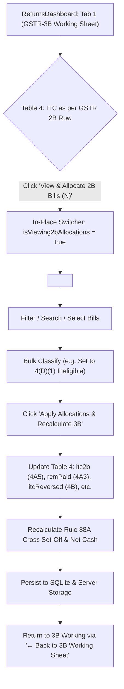

# Phase 19: Research & Technical Architecture — GSTR-3B Inward ITC Manual Allocation & Voucher-Level Audit Workbench

## 1. Database Layer: Schema & Query Architecture

### A. Existing Schema: `gstr2b_invoices`
In `gstr2b/db.js`, 2B line-item records are stored in `gstr2b_invoices`:
```sql
CREATE TABLE IF NOT EXISTS gstr2b_invoices (
    id TEXT PRIMARY KEY,
    batch_id TEXT,
    client_gstin TEXT NOT NULL,
    return_period TEXT NOT NULL,
    section TEXT DEFAULT 'B2B',
    ctin TEXT NOT NULL,
    supplier_name TEXT,
    inum TEXT NOT NULL,
    idt TEXT NOT NULL,
    inv_typ TEXT DEFAULT 'Regular',
    pos TEXT,
    rchrg TEXT DEFAULT 'N',
    itc_available TEXT DEFAULT 'Y',
    itc_reason TEXT,
    txval REAL DEFAULT 0,
    igst REAL DEFAULT 0,
    cgst REAL DEFAULT 0,
    sgst REAL DEFAULT 0,
    cess REAL DEFAULT 0,
    total_val REAL DEFAULT 0,
    source_period TEXT,
    filing_date TEXT,
    created_at INTEGER,
    UNIQUE(client_gstin, return_period, section, ctin, inum, idt)
);
```

### B. New Dedicated Table: `gstr3b_itc_allocations`
To maintain an immutable, multi-user audit trail of where each voucher is directed in GSTR-3B:
```sql
CREATE TABLE IF NOT EXISTS gstr3b_itc_allocations (
    id TEXT PRIMARY KEY,
    client_gstin TEXT NOT NULL,
    return_period TEXT NOT NULL,
    invoice_id TEXT NOT NULL,
    target_table TEXT NOT NULL,  -- '4A5', '4A3', '4A1', '4B1', '4B2', '4D1', '4D2', 'DEFERRED'
    notes TEXT,
    allocated_by TEXT DEFAULT 'User',
    created_at INTEGER,
    updated_at INTEGER,
    UNIQUE(client_gstin, return_period, invoice_id)
);
CREATE INDEX IF NOT EXISTS idx_gstr3b_itc_alloc_client ON gstr3b_itc_allocations(client_gstin, return_period);
```

### C. Unified Query with Intelligent Statutory Defaults
When loading invoices for the workbench, a `LEFT JOIN` seamlessly combines raw 2B invoices with existing user allocations, while computing statutory defaults for unallocated invoices:
```sql
SELECT 
    i.id,
    i.batch_id,
    i.client_gstin,
    i.return_period,
    i.section,
    i.ctin,
    COALESCE(i.supplier_name, i.ctin) AS supplier_name,
    i.inum,
    i.idt,
    i.inv_typ,
    i.pos,
    i.rchrg,
    i.itc_available,
    i.itc_reason,
    COALESCE(i.txval, 0) AS txval,
    COALESCE(i.igst, 0) AS igst,
    COALESCE(i.cgst, 0) AS cgst,
    COALESCE(i.sgst, 0) AS sgst,
    COALESCE(i.cess, 0) AS cess,
    COALESCE(i.total_val, 0) AS total_val,
    (COALESCE(i.igst, 0) + COALESCE(i.cgst, 0) + COALESCE(i.sgst, 0) + COALESCE(i.cess, 0)) AS total_tax,
    COALESCE(a.target_table, 
        CASE 
            WHEN UPPER(i.rchrg) = 'Y' THEN '4A3'
            WHEN UPPER(i.inv_typ) LIKE '%CBW%' OR UPPER(i.section) LIKE '%IMPG%' THEN '4A1'
            WHEN UPPER(i.itc_available) = 'N' THEN '4D1'
            ELSE '4A5'
        END
    ) AS target_table,
    a.notes,
    a.updated_at AS allocated_at
FROM gstr2b_invoices i
LEFT JOIN gstr3b_itc_allocations a 
    ON UPPER(a.client_gstin) = UPPER(i.client_gstin) 
    AND a.return_period = i.return_period 
    AND a.invoice_id = i.id
WHERE UPPER(i.client_gstin) = UPPER(?) AND (
    i.return_period = ? OR 
    i.return_period LIKE ? OR 
    i.return_period LIKE ?
)
ORDER BY 
    CASE 
        WHEN UPPER(i.section) LIKE '%B2B%' THEN 1 
        WHEN UPPER(i.section) LIKE '%CDNR%' THEN 2 
        ELSE 3 
    END,
    i.idt DESC, i.inum ASC;
```

---

## 2. API Contract

### Endpoint 1: Fetch Invoices & Allocation Summary
- **Route:** `GET /api/gstr3b/itc-allocations/:gstin`
- **Query Params:** `period` (e.g. `June 2025` or `062025`)
- **Response Format:**
```json
{
  "success": true,
  "clientGstin": "27AABCV1234F1Z5",
  "returnPeriod": "June 2025",
  "summary": {
    "totalInvoices": 142,
    "totalTaxable": 1542000.00,
    "totalTax": 277560.00,
    "eligible_4a5": { "count": 128, "taxable": 1420000.00, "igst": 120000.00, "cgst": 67800.00, "sgst": 67800.00, "cess": 0.00, "total": 255600.00 },
    "rcm_4a3": { "count": 4, "taxable": 45000.00, "igst": 2250.00, "cgst": 0.00, "sgst": 0.00, "cess": 0.00, "total": 2250.00 },
    "import_4a1": { "count": 2, "taxable": 35000.00, "igst": 6300.00, "cgst": 0.00, "sgst": 0.00, "cess": 0.00, "total": 6300.00 },
    "reversal_4b1": { "count": 3, "taxable": 18000.00, "igst": 3240.00, "cgst": 0.00, "sgst": 0.00, "cess": 0.00, "total": 3240.00 },
    "reversal_4b2": { "count": 0, "taxable": 0.00, "igst": 0.00, "cgst": 0.00, "sgst": 0.00, "cess": 0.00, "total": 0.00 },
    "ineligible_4d1": { "count": 3, "taxable": 16000.00, "igst": 0.00, "cgst": 1440.00, "sgst": 1440.00, "cess": 0.00, "total": 2880.00 },
    "ineligible_4d2": { "count": 1, "taxable": 5000.00, "igst": 900.00, "cgst": 0.00, "sgst": 0.00, "cess": 0.00, "total": 900.00 },
    "deferred": { "count": 1, "taxable": 3000.00, "igst": 540.00, "cgst": 0.00, "sgst": 0.00, "cess": 0.00, "total": 540.00 }
  },
  "invoices": [...]
}
```

### Endpoint 2: Bulk Save / Update Allocations
- **Route:** `POST /api/gstr3b/itc-allocations`
- **Payload:**
```json
{
  "clientGstin": "27AABCV1234F1Z5",
  "returnPeriod": "June 2025",
  "allocations": [
    {
      "invoiceId": "INV-001",
      "targetTable": "4D1",
      "notes": "Motor vehicle repair blocked u/s 17(5)(a)"
    }
  ]
}
```

### Endpoint 3: Statutory Zero-Merge Excel Audit Annexure
- **Route:** `GET /api/gstr3b/export-itc-allocations?gstin=...&period=...`
- **Output:** Streams `.xlsx` file with 5 dedicated tabs:
  1. `Allocation Summary`
  2. `Eligible ITC 4(A)(5)`
  3. `Ineligible Credit 4(D)`
  4. `ITC Reversals 4(B)`
  5. `Deferred Vouchers`
- **Architectural Rule:** Enforces `ws['!merges'] = []` across all sheets so filtering and VLOOKUP work without restriction.

---

## 3. UI/UX Interaction Design in `ReturnsDashboard.tsx`



### Key UI Features of Workbench:
1. **Sticky Top Banner:**
   - Client GSTIN & Name, active Return Period (e.g., June 2025).
   - `← Back to GSTR-3B Working Sheet` prominent button.
   - Live reconciliation badge: `Reconciled: 142/142 Vouchers (100%)`.
   - `Export Audit Sheet (Excel)` button.
   - `Apply to 3B Working Sheet` primary button with gradient styling.
2. **Top Metric Cards (KPI Summary Deck):**
   - **Total 2B Inward:** Total Vouchers & Total Tax (₹).
   - **4(A)(5) Eligible ITC:** Amount to be claimed in Table 4.
   - **4(D)(1) Blocked u/s 17(5):** Vehicles, catering, etc.
   - **4(D)(2) Restricted u/s 16(4):** Time-barred.
   - **4(B) Reversals:** Rule 38/42/43 reversals.
   - **4(A)(3) RCM Supplies:** Auto-populated in 3.1(d) & 4(A)(3).
   - **Deferred Bills:** Held back from 3B.
3. **Filter & Action Toolbar:**
   - Search input (instant filter on GSTIN, Legal Name, Invoice No).
   - Category filter tabs (`All (142)`, `Eligible (128)`, `Ineligible (4)`, `Reversals (3)`, `RCM (4)`, `Deferred (1)`).
   - Bulk actions bar (appears when $\ge 1$ row is selected):
     - `Mark as 4(A)(5) Eligible`
     - `Mark as 4(D)(1) Ineligible 17(5)`
     - `Mark as 4(B)(1) Reversal`
     - `Defer / Hold`
4. **Interactive Data Table:**
   - Multi-select checkbox.
   - Section badge (B2B, CDNR, B2BA).
   - Supplier GSTIN & Legal Name.
   - Invoice No & Date.
   - Taxable Value, IGST, CGST, SGST, Total Tax.
   - RCM Indicator (`Yes` / `No`).
   - Destination Dropdown (`4(A)(5) Eligible`, `4(A)(3) RCM`, `4(A)(1) Import`, `4(B)(1) Reversal 17(5)`, `4(B)(2) Reversal Other`, `4(D)(1) Ineligible 17(5)`, `4(D)(2) Ineligible 16(4)`, `Deferred`).
   - Audit Note (free text input for reasons).

---

## 4. Integration with `gstr3bEngine.ts`

When applying allocations:
```typescript
const applyAllocations = (summary: AllocationSummary) => {
  setWorkingData(prev => {
    const cloned = JSON.parse(JSON.stringify(prev)) as GSTR3BAnnualWorking;
    const cur = cloned.months[selectedMonth];
    
    // 1. Table 4(A)(5): All Other ITC = Eligible 4A5 vouchers
    cur.inward.itc2b = {
      taxable: summary.eligible_4a5.taxable,
      igst: summary.eligible_4a5.igst,
      cgst: summary.eligible_4a5.cgst,
      sgst: summary.eligible_4a5.sgst,
      total: summary.eligible_4a5.total
    };

    // 2. Table 4(A)(3): Inward RCM
    if (summary.rcm_4a3.total > 0) {
      cur.inward.rcmPaid = {
        taxable: summary.rcm_4a3.taxable,
        igst: summary.rcm_4a3.igst,
        cgst: summary.rcm_4a3.cgst,
        sgst: summary.rcm_4a3.sgst,
        total: summary.rcm_4a3.total
      };
      // Also sync Table 3.1(d) outward RCM liability
      cur.outward.rcmInward = {
        taxable: summary.rcm_4a3.taxable,
        igst: summary.rcm_4a3.igst,
        cgst: summary.rcm_4a3.cgst,
        sgst: summary.rcm_4a3.sgst,
        total: summary.rcm_4a3.total
      };
    }

    // 3. Table 4(A)(1): Import of Goods
    if (summary.import_4a1.total > 0) {
      cur.inward.importGoods = {
        taxable: summary.import_4a1.taxable,
        igst: summary.import_4a1.igst,
        cgst: 0,
        sgst: 0,
        total: summary.import_4a1.total
      };
    }

    // 4. Table 4(B): ITC Reversals (4B1 + 4B2)
    const revTotal = (summary.reversal_4b1.total || 0) + (summary.reversal_4b2.total || 0);
    if (revTotal > 0) {
      cur.inward.itcReversed = {
        taxable: (summary.reversal_4b1.taxable || 0) + (summary.reversal_4b2.taxable || 0),
        igst: (summary.reversal_4b1.igst || 0) + (summary.reversal_4b2.igst || 0),
        cgst: (summary.reversal_4b1.cgst || 0) + (summary.reversal_4b2.cgst || 0),
        sgst: (summary.reversal_4b1.sgst || 0) + (summary.reversal_4b2.sgst || 0),
        total: revTotal
      };
    }

    // 5. Track Table 4(D) Ineligible details
    (cur.inward as any).ineligibleItc = {
      taxable: (summary.ineligible_4d1.taxable || 0) + (summary.ineligible_4d2.taxable || 0),
      igst: (summary.ineligible_4d1.igst || 0) + (summary.ineligible_4d2.igst || 0),
      cgst: (summary.ineligible_4d1.cgst || 0) + (summary.ineligible_4d2.cgst || 0),
      sgst: (summary.ineligible_4d1.sgst || 0) + (summary.ineligible_4d2.sgst || 0),
      total: (summary.ineligible_4d1.total || 0) + (summary.ineligible_4d2.total || 0)
    };

    // 6. Recalculate annual working & Rule 88A set-off cascade
    const recalculated = recalculateAnnualWorking(cloned);
    saveToServerStorage(recalculated).catch(console.error);
    return recalculated;
  });
};
```
