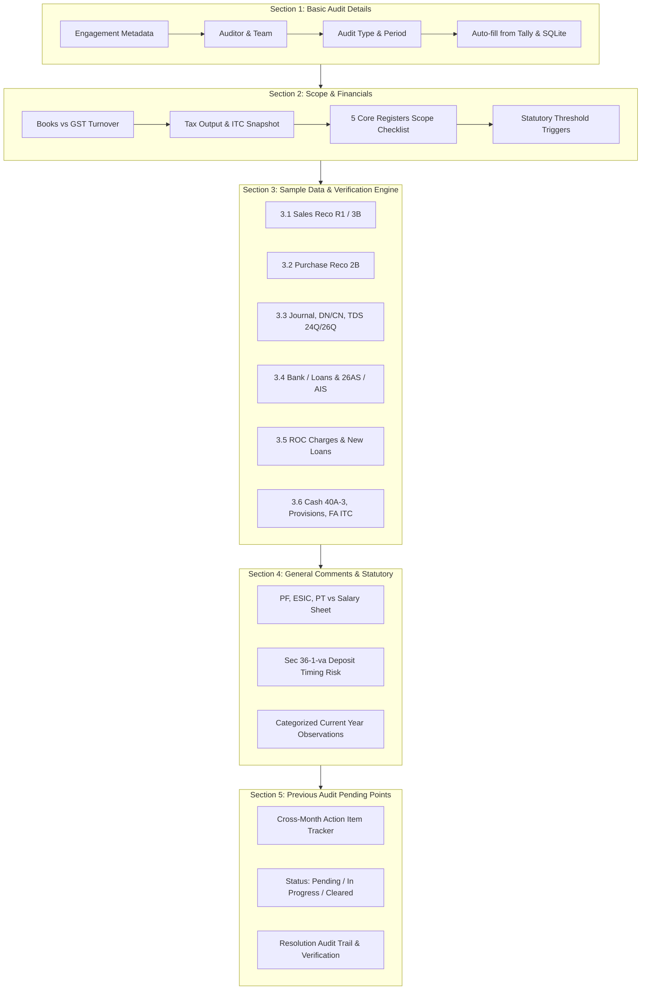

# Phase 26 Research: Monthly Audit Format & Working Paper Verification Suite

**Phase:** 26 — Monthly Audit Format & Working Paper Verification Suite  
**Milestone:** Vaswani Return Enterprise (Audit With Vaswani)  
**Target Completion:** Comprehensive Architecture, Data Models, Verification Engines & Implementation Blueprints  
**Status:** Completed  
**Author:** Phase Researcher Agent  

---

## Executive Summary

Phase 26 digitizes, automates, and institutionalizes the standardized monthly internal and statutory audit verification process used by Chartered Accountancy firms. Modeled directly on the live CA firm checklist (`\\new_server\D\3. 2025-2026\DYP Infraprojects Private Limited\Monthly Audit Format.docx`) and cross-month pending work trackers (`Work Pending List.xlsx`), this suite transforms manual, fragmented Word/Excel audit checklists into an automated, interactive, local-first verification engine.

The suite solves four major bottlenecks in statutory audit workflows:
1. **Manual Data Extraction:** Eliminates repetitive copy-pasting by pulling live vouchers, ledgers, fixed asset additions, cash transactions, and TDS records directly from TallyPrime via Port 9000 XML collections.
2. **Multi-Source Cross-Reconciliation:** Automatically cross-checks Books Sales against GSTR-1 and GSTR-3B, Books Purchases against GSTR-2B, Payroll against PF/ESIC/PT, and Bank/Loan balances against 26AS/AIS.
3. **Audit Trail & Action Item Continuity:** Persistently tracks pending audit points across monthly cycles with status transitions (`Pending` $\rightarrow$ `In Progress` $\rightarrow$ `Cleared`), resolution audit trails, and client-level aggregation.
4. **Strict Zero-Merge Analytical Workbooks:** Generates an 8-sheet, audit-grade Excel working paper (`Monthly_Audit_Working_Paper_{Client}_{Month}.xlsx`) with zero merged cells (`ws['!merges'] = []`), preserving sorting, AutoFilters, and lookup formulas (`XLOOKUP`, `VLOOKUP`).

---

## 1. Deep Analysis of the Reference Standardized Audit Format

Inspection of the actual firm document `\\new_server\D\3. 2025-2026\DYP Infraprojects Private Limited\Monthly Audit Format.docx` and companion tracker `Work Pending List.xlsx` establishes the foundational structure:

### 1.1 Engagement Profile & Metadata (Basic Audit Details)
The top section of the firm format records engagement parameters:
- **Client Name:** Entity name undergoing audit.
- **Auditor Name:** Engagement partner / senior auditor.
- **Audit Team Members:** Article clerks and audit associates conducting field vouching.
- **Type of Audit:** Monthly Statutory Audit / Internal Audit / Tax Audit Pre-Scrutiny / Management Review.
- **Month and FY of Audit:** Target period (e.g., October 2025, FY 2025-26).
- **Turnover inc. GST:** Overall gross revenue including applicable GST.
- **Audit Duration:** Audit Start Date and Audit End Date.

### 1.2 Scope & Verification Items (Sr. No. 1 to 8)
The standardized format specifies the following exact items:

| Sr. No. | Section / Particulars | Detailed Audit Requirement |
|---|---|---|
| **1** | **Vouching & Verification of Core Registers** | Scrutiny and substantive vouching of: <br>• Sales Register <br>• Purchase Register <br>• Journal Register <br>• Debit and Credit Notes <br>• Bank and Loan Account Statements |
| **2** | **Verification of Key Workings** | • **GST Monthly Working:** Sales Working & Reconciliation with GSTR-3B and GSTR-1; ITC Working & Reconciliation with GSTR-2B received from office.<br>• **TDS Workings:** TDS Annual Working, TDS Annual Consolidated Working, Reconciliation of Form 24Q (Salary), Reconciliation of Form 26Q (Non-Salary).<br>• **Depreciation Working of Fixed Assets:** Companies Act (Schedule II useful lives) vs Income Tax Act (Block of assets, Sec 32) & Deferred Tax Calculations.<br>• **Ledger Scrutiny:** Comprehensive ledger examination for anomalous balances.<br>• **Payroll & Labor Compliances:** PF, PT, and ESIC Calculation Sheets cross-verified against Salary Sheet.<br>• **26AS Reconciliation:** Reconciliation of Form 26AS with Books of Accounts. |
| **3** | **Provisions Scrutiny** | Check all Closing Provisions created (expenses, interest, audit fees) and Opening Provisions reversed. |
| **4** | **Cash Transactions Compliance** | Check for single-day cash payments exceeding ₹10,000 (Section 40A(3) disallowance risk). |
| **5** | **ROC Compliance (Pvt Ltd & LLP)** | Check for charges created, modified, or satisfied during the year with ROC records (Form CHG-1 & CHG-4). |
| **6** | **AIS / TIS Reconciliation** | Reconcile Annual Information Statement (AIS) and Taxpayer Information Summary (TIS) with Books of Accounts. |
| **7** | **Fixed Assets ITC Ineligibility** | Check for ineligible ITC on Fixed Asset additions (capital goods under Sec 17(5)(c)/(d) for immovable property) and prevent depreciation double-dipping. |
| **8** | **Observations & Action Tracking** | Current month audit comments categorized by risk, plus persistent tracking of prior audit pending points. |

### 1.3 CA Firm Cross-Month Action Tracker (`Work Pending List.xlsx`)
Inspection of `Work Pending List.xlsx` in the same directory revealed that CA offices manage pending points across five distinct functional buckets:
1. `TDS Pending` (e.g., return filing, challan payments, short deduction queries)
2. `ITR Pending` (e.g., return filing, partner computations, Form 92EB)
3. `Financials and Print Out` (e.g., printouts pending, partner signatures, finalization sign-offs)
4. `Audits / Observations` (e.g., specific client compliance queries, unvouched ledgers)
5. `Resolution Tracking` (`Payment pending`, `COI Sent`, `No Information`, `Resolved`)

Our database schema and UI must support these real-world CA firm practices.

---

## 2. Existing Codebase Inspection & Reusable Capabilities

The application already has powerful analytical components that can be leveraged directly:

```
reco-with-vaswani-main/
├── src/
│   ├── pages/
│   │   ├── AuditModule.tsx             # Menu and current 8 audit submodules
│   │   ├── DepreciationAuditor.tsx     # Dual-engine Companies Act + IT Act depreciation
│   │   ├── ForensicAudit.tsx           # Benford's law, voucher gaps, journal anomalies
│   │   ├── TaxAuditClause44.tsx        # Clause 44 GST expenditure scrutiny
│   │   └── TdsReconciliation.tsx       # Form 24Q, 26Q & Traces reconciliation
│   └── lib/
│       ├── auditEngine.ts              # Cash 40A(3), Sampling, Direct Expenses, Finalisation Scrutiny
│       ├── tallyApi.ts                 # Port 9000 live XML integration
│       ├── reconciliation.ts           # 8-pass PR vs 2B matching engine
│       ├── gstr1Engine.ts              # GSTR-1 outward tax liability engine
│       ├── gstr3bEngine.ts             # GSTR-3B monthly computation engine
│       └── finStatementsExport.ts      # Zero-Merge Excel generation engine
├── server.js                           # Express backend & SQLite initialization
├── returns_storage_routes.js           # Direct client directory storage (/gst_returns_data)
├── audit_trail_routes.js               # Immutable audit log routes
└── tds_routes.js                       # TDS reconciliation routes
```

### Key Reusable Assets:
1. **Live Tally XML Bridge (`src/lib/tallyApi.ts`):**
   - `fetchCompanyInfo(config)`: Fetches active Tally company name, dates, currency.
   - `fetchTallyMetadata(config)`: Fetches GSTIN maps, parent groups, ledger names.
   - `fetchVouchers(voucherType)`: Fetches full voucher arrays for `Sales`, `Purchase`, `Journal`, `Payment`, `Receipt`.
   - `fetchLedgerVouchers(ledgerNames)`: Fetches specific ledger entries.
   - `fetchFixedAssetsFromTally(fromDate, toDate)`: Returns all fixed asset additions during the month.
   - `fetchFinalisationDataFromTally(fromDate, toDate)`: Scans party balances and ledger groups.
2. **Auditing Algorithms (`src/lib/auditEngine.ts`):**
   - `runCashComplianceAudit(cashVouchers)`: Detects cash payments > ₹10,000 u/s 40A(3), 269SS/T loan violations, and daily negative balances.
   - `runAuditSampling(vouchers, config)`: Generates high-value, random, systematic, or stratified audit samples per SA 530.
   - `runCreditorFinalisationScrutiny(tallyData)`: 12 CA scrutiny rules including Transporter 194C(6) PAN declaration, 194Q TDS, 194I(a) hire charges.
   - `analyzeJournalEntries(vouchers)`: Identifies anomalous journal narrations and capital-to-revenue reclassifications.
3. **GST Inward & Outward Engines:**
   - `reconcile()` in `src/lib/reconciliation.ts`: 8-pass waterfall matching between Books and GSTR-2B.
   - `gstr1_batches` and `gstr1_invoices` in SQLite: GSTR-1 outward supplies.
   - `gstr3b_returns` in SQLite: GSTR-3B Table 3.1 outward tax and Table 4 inward ITC.
4. **Direct Client Auto-Save Architecture (`returns_storage_routes.js`):**
   - Resolves structured client folders: `gst_returns_data/<Client Name - GSTIN>/<FY>/<Month>/Audit Working/`.
   - Eliminates browser file save dialogs on auto-save while retaining explicit Excel downloads.

---

## 3. Five Core Sections: Detailed Specification & Verification Mechanics



### Section 1: Basic Audit Details & Engagement Metadata
- **Data Attributes:**
  - `client_name`: Entity name (auto-selected from client dropdown or Tally active company).
  - `client_gstin`: 15-character GSTIN (auto-populated from SQLite `clients` or Tally metadata).
  - `auditor_name`: Name of CA partner / senior auditor.
  - `team_members`: Array of audit associates (stored as JSON array, rendered as interactive badge pills).
  - `audit_type`: Enum: `Monthly Statutory Audit`, `Internal Audit`, `Tax Audit Pre-Scrutiny`, `Management Review`.
  - `audit_month`: Selected month (April through March).
  - `audit_fy`: Financial Year (e.g. `2025-26`).
  - `turnover_inc_gst`: Gross turnover including taxes.
  - `audit_start_date` & `audit_end_date`: Calendar date range of audit fieldwork.
  - `audit_status`: `Draft`, `In Progress`, `Under Review`, `Completed`.
- **Auto-Fill Logic:**
  - On selecting a client, query `/api/clients` and Tally Port 9000 (`fetchCompanyInfo`).
  - Pre-fill turnover from Books Sales closing balance + GST liability.

### Section 2: Financial Details & Engagement Scope
- **Comparative Revenue & Tax Snapshot:**
  - **Books Turnover (Excl GST):** Sum of Sales ledger credits for the month.
  - **GSTR-1 Taxable Turnover:** Sum of Table 4A, 4B, 5, 6, 7 outward taxable supplies.
  - **GSTR-3B Taxable Turnover:** Table 3.1(a) taxable supplies.
  - **Variance Computation:**
    $$\Delta \text{Turnover}_{1} = \text{Turnover}_{\text{Books}} - \text{Turnover}_{\text{GSTR-1}}$$
    $$\Delta \text{Turnover}_{2} = \text{Turnover}_{\text{GSTR-1}} - \text{Turnover}_{\text{GSTR-3B}}$$
  - **Threshold Triggers:**
    - If Turnover > ₹5 Cr: Flag E-Invoicing applicability and 6-digit HSN requirement.
    - If Turnover > ₹10 Cr: Flag Section 44AB Tax Audit applicability.
- **5 Core Registers Vouching Checklist:**
  - Standardized checklist rows:
    1. Sales Register
    2. Purchase Register
    3. Journal Register
    4. Debit and Credit Notes Register
    5. Bank and Loan Account Statements
  - Columns: Vouched (`Yes` / `No` / `Partial`), Sample Checked (`100%`, `High-value`, `Random 25%`), Total Vouchers Count, Audited Amount, Auditor Notes.

### Section 3: Sample Data & Verification Engine (Core Workings)

#### 3.1 Sales Working (Reco R1 & 3B)
- Cross-reconciles Books Sales Register against GSTR-1 and GSTR-3B.
- Real-time detection of:
  - Unreported sales (invoices booked in Tally but omitted in GSTR-1).
  - Rate mismatches (e.g., booked at 18%, filed at 12% in R1).
  - DRC-01B variances (GSTR-1 tax liability exceeds GSTR-3B paid liability by > ₹25,000 or > 20%).
  - Export / Zero-rated supplies verification (LUT vs with-tax payment).

#### 3.2 Purchase Working (Reco with 2B)
- Cross-reconciles Books Purchase Register against GSTR-2B inward supplies.
- Automatically groups discrepancies:
  - Missing in 2B (unreflected ITC, vendor non-filing).
  - Missing in Books (unrecorded vendor invoices or liabilities).
  - Value / Tax Mismatch (> ₹2 tolerance).
  - Section 16(4) time-limit scrutiny (invoices belonging to previous FY booked past November 30).
  - Ineligible ITC u/s 17(5) (motor vehicles, food/beverages, personal consumption).

#### 3.3 Journal Register, Debit/Credit Notes & TDS Scrutiny
- **Journal Register Scrutiny:**
  - Scans non-cash, non-bank entries in Tally (`fetchVouchers('Journal')`).
  - Flags entries with words like `Suspense`, `Adjustment`, `Difference`, `Rectification`, `Write off`, `Director`.
  - Flags revenue items capitalized or capital expenditure expensed.
- **Debit / Credit Notes Pairing:**
  - Reconciles DN/CN against portal CDNR records using the existing waterfall matching algorithm.
- **TDS Workings & Statutory Returns Reco:**
  - **Form 24Q (Salary TDS):** Cross-verifies Salary Register against Form 24Q deductions under Section 192.
  - **Form 26Q (Non-Salary TDS):** Cross-verifies vendor expense ledgers against Form 26Q deductions:
    - Sec 194C (Contractors / Transporters): Checks Transporter 194C(6) declaration when no TDS is deducted.
    - Sec 194J (Professional / Technical Fees): 10% vs 2% rate scrutiny.
    - Sec 194I (Rent): Land/Building (10%) vs Plant/Machinery (2%).
    - Sec 194Q (Purchase of Goods): Checks 0.1% TDS when aggregate vendor purchase exceeds ₹50 Lakhs.

#### 3.4 Bank Statements & Loan Statements (Including 26AS & AIS Reco)
- **Bank Statements & BRS:**
  - Verifies bank reconciliations, stale cheques (> 3 months), and uncredited deposits.
- **Loan Statements:**
  - Verifies interest servicing, EMI payment schedules, and principal vs interest split.
  - Checks for penal interest or default charges.
- **Form 26AS Reconciliation:**
  - Cross-reconciles TDS credit per 26AS with TDS Receivable ledger in Books.
  - Flags mismatches where clients deducted TDS but failed to deposit or report in Form 26Q.
- **AIS / TIS Statement Reconciliation:**
  - Matches interest income (Savings & FD) per AIS with Books P&L.
  - Flags High-Value Transactions (SFT) reported in AIS (cash deposits, property, securities).
  - Matches GST outward turnover reported in AIS with Books Sales.

#### 3.5 New Loans Taken & ROC Compliance
- Tracks all new loans (Secured & Unsecured) introduced during the month.
- **Section 269SS / 269T Check:** Checks that no loan/deposit of ₹20,000 or more was accepted or repaid in cash.
- **ROC Charges Compliance (Pvt Ltd & LLP):**
  - For new secured loans or mortgaged assets: verifies creation of charge in Form CHG-1 within 30 days.
  - For fully repaid loans: verifies satisfaction of charge in Form CHG-4 within 30 days.
  - Checks Director loan declarations confirming funds are from personal sources and not borrowings.

#### 3.6 Cash Register & Compliance (Sec 40A(3), Provisions, FA ITC)
- **Section 40A(3) Compliance:**
  - Daily daybook analysis for aggregate payments exceeding ₹10,000 to a single party in cash (₹35,000 for transport operators).
  - Identifies disallowance risk under Section 40A(3).
- **Negative Cash Balance Check:**
  - Daily chronological balance tracking; flags any date where cash ledger shows a credit balance.
- **Closing & Opening Provisions:**
  - Verification that month-end provisions are created (salaries, utility bills, audit fees, interest).
  - Verification that opening provisions of the previous month were correctly reversed or knocked off against actual payments.
- **Fixed Asset Additions & Ineligible ITC:**
  - Scans Fixed Asset ledger additions (`fetchFixedAssetsFromTally`).
  - Section 17(5)(c) check: ITC blocked on works contract services for construction of immovable property.
  - Section 17(5)(d) check: ITC blocked on goods or services for construction of immovable property on own account.
  - Double-dip guardrail: Ensures GST amount is either capitalized (for IT Act depreciation) OR claimed as ITC (under CGST Act), but strictly not both.

### Section 4: General Comments & Statutory Compliances

#### 4.1 PF, ESIC & Professional Tax (PT)
- **Provident Fund (PF):**
  - Gross salary vs EPF wage ceiling (₹15,000 basic + DA).
  - Computes 12% employee share + 12% employer share (3.67% EPF + 8.33% EPS) + EDLI (0.5%) + Admin charges (0.5%).
  - Deposit Due Date: 15th of the following month.
  - **Section 36(1)(va) Critical Risk Guardrail:** Flags employee contributions deposited after the 15th as permanent disallowance (Supreme Court *Checkmate Services* precedent).
- **ESIC:**
  - Wage ceiling check (₹21,000/mo).
  - 0.75% employee contribution + 3.25% employer contribution.
  - Deposit Due Date: 15th of the following month.
- **Professional Tax (PT):**
  - State-specific slab check (e.g. Maharashtra slab: ₹200/mo, ₹300 in Feb).
  - Deposit Due Date: Last day of the following month.

#### 4.2 Current Year Audit Comments
- Structured observations with:
  - `Risk Level`: `Critical`, `High`, `Medium`, `Low`, `Information`.
  - `Category`: `Tax Exposure`, `Statutory Non-Compliance`, `Internal Control Deficiency`, `Documentation Gap`, `Accounting Error`.
  - `Financial Exposure Amount`: Monetary impact.
  - `Voucher Reference`: Specific voucher number and date.
  - `Auditor Recommendation` & `Management Response`.
  - Quick action: "Push to Previous Pending Points" to track in subsequent months.

### Section 5: Previous Audit Pending Points
- Persistent tracker across all monthly audit cycles.
- **Lifecycle & State Machine:**
  ```mermaid
  stateDiagram-v2
      [*] --> Pending: Point Raised in Month M
      Pending --> In_Progress: Client Contacted / Working
      In_Progress --> Cleared: Evidence Verified in Month N
      In_Progress --> Pending: Unresolved, Carried Forward
      Pending --> Cleared: Directly Resolved
      Cleared --> [*]
  ```
- **Fields:** Point Title, Description, Category (Sales, Purchase, TDS, Cash, Statutory, ROC, Banking, Documentation), Severity, Status (`Pending` | `In Progress` | `Cleared`), Assigned To, Target Date, Resolution Remarks, Resolved in Month, Verifying Auditor, Timestamps.
- **Automated Carry-Forward:** When starting Month $N$, all open points from Month $N-1$ or earlier are automatically pulled in.

---

## 4. SQLite Database Architecture & Schema

To maintain offline, local-first performance and zero cloud dependency, all audit records are stored in the application's central SQLite database (`DB_PATH`).

```sql
-- 1. Master Monthly Audit Record
CREATE TABLE IF NOT EXISTS monthly_audits (
  id TEXT PRIMARY KEY,                       -- e.g. 'audit_27AABCU9603R1ZM_2025-26_10'
  client_gstin TEXT NOT NULL,
  client_name TEXT NOT NULL,
  fy TEXT NOT NULL,                          -- '2025-26'
  month TEXT NOT NULL,                       -- 'October' or '10'
  auditor_name TEXT,
  team_members TEXT,                         -- JSON array of strings: '["Amit S", "Priya K"]'
  audit_type TEXT DEFAULT 'Monthly Statutory Audit',
  turnover_inc_gst REAL DEFAULT 0,
  turnover_books REAL DEFAULT 0,
  turnover_gst REAL DEFAULT 0,
  turnover_variance REAL DEFAULT 0,
  audit_start_date TEXT,
  audit_end_date TEXT,
  status TEXT DEFAULT 'Draft',               -- 'Draft', 'In Progress', 'Under Review', 'Completed'
  general_summary TEXT,
  metadata TEXT,                             -- JSON blob for extra parameters
  created_at INTEGER NOT NULL,
  updated_at INTEGER NOT NULL
);

CREATE INDEX IF NOT EXISTS idx_monthly_audits_client ON monthly_audits (client_gstin, fy);
CREATE INDEX IF NOT EXISTS idx_monthly_audits_status ON monthly_audits (status);

-- 2. Audit Verification Checklists (Items 1 to 8)
CREATE TABLE IF NOT EXISTS audit_checklists (
  id TEXT PRIMARY KEY,
  audit_id TEXT NOT NULL,
  section_key TEXT NOT NULL,                 -- 'vouching_scope', 'gst_working', 'tds_working', 'depreciation', 'provisions', 'cash_40a3', 'roc_charges', 'ais_reco', 'fa_itc', 'pf_esic_pt'
  item_key TEXT NOT NULL,                    -- 'sales_register', 'reco_3b', 'reco_r1', 'form_24q', etc.
  item_title TEXT NOT NULL,
  status TEXT DEFAULT 'Pending',             -- 'Verified', 'Discrepancy Found', 'Not Applicable', 'Pending'
  sample_checked TEXT,                       -- '100%', '25 vouchers', 'High-value > 1L'
  remarks TEXT,
  amount_involved REAL DEFAULT 0,
  updated_at INTEGER NOT NULL,
  FOREIGN KEY (audit_id) REFERENCES monthly_audits(id) ON DELETE CASCADE
);

CREATE INDEX IF NOT EXISTS idx_audit_checklists_audit_id ON audit_checklists (audit_id);

-- 3. Current Month Audit Observations
CREATE TABLE IF NOT EXISTS audit_observations (
  id TEXT PRIMARY KEY,
  audit_id TEXT NOT NULL,
  client_gstin TEXT NOT NULL,
  section_key TEXT NOT NULL,                 -- 'sales', 'purchase', 'journal', 'bank_loans', 'cash', 'statutory_pf_esic', 'general'
  title TEXT NOT NULL,
  description TEXT NOT NULL,
  severity TEXT NOT NULL DEFAULT 'Medium',   -- 'Critical', 'High', 'Medium', 'Low', 'Info'
  risk_category TEXT,                        -- 'Tax Exposure', 'Statutory Non-Compliance', 'Internal Control Gap', 'Accounting Error'
  financial_exposure REAL DEFAULT 0,
  voucher_ref TEXT,
  auditor_recommendation TEXT,
  management_response TEXT,
  status TEXT DEFAULT 'Open',                -- 'Open', 'Discussed', 'Resolved', 'Carried Forward'
  created_at INTEGER NOT NULL,
  updated_at INTEGER NOT NULL,
  FOREIGN KEY (audit_id) REFERENCES monthly_audits(id) ON DELETE CASCADE
);

CREATE INDEX IF NOT EXISTS idx_audit_observations_audit_id ON audit_observations (audit_id);
CREATE INDEX IF NOT EXISTS idx_audit_observations_client ON audit_observations (client_gstin);

-- 4. Cross-Month Persistent Audit Pending Points
CREATE TABLE IF NOT EXISTS audit_pending_points (
  id TEXT PRIMARY KEY,
  client_gstin TEXT NOT NULL,
  client_name TEXT NOT NULL,
  origin_audit_id TEXT NOT NULL,
  origin_fy TEXT NOT NULL,
  origin_month TEXT NOT NULL,
  point_title TEXT NOT NULL,
  point_description TEXT NOT NULL,
  category TEXT NOT NULL,                    -- 'Sales', 'Purchase', 'TDS', 'Cash', 'Statutory', 'ROC', 'Banking', 'Documentation', 'General'
  severity TEXT NOT NULL DEFAULT 'Medium',   -- 'High', 'Medium', 'Low'
  status TEXT NOT NULL DEFAULT 'Pending',    -- 'Pending', 'In Progress', 'Cleared'
  assigned_to TEXT,
  target_date TEXT,
  resolution_remarks TEXT,
  resolved_in_month TEXT,
  verified_by TEXT,
  created_at INTEGER NOT NULL,
  cleared_at INTEGER,
  updated_at INTEGER NOT NULL
);

CREATE INDEX IF NOT EXISTS idx_pending_points_client ON audit_pending_points (client_gstin, status);
CREATE INDEX IF NOT EXISTS idx_pending_points_origin ON audit_pending_points (origin_audit_id);

-- 5. Audit Verification Computed Data Cache (Live Scans Snapshot)
CREATE TABLE IF NOT EXISTS audit_verification_data (
  audit_id TEXT PRIMARY KEY,
  sales_reco_data TEXT,                      -- JSON: Books vs R1 vs 3B turnover & tax breakdown
  purchase_reco_data TEXT,                   -- JSON: Books vs 2B summary, matched, missing in 2B
  cash_compliance_data TEXT,                 -- JSON: 40A(3) violations count & total, negative balance logs
  statutory_compliance_data TEXT,            -- JSON: PF, ESIC, PT wage/deposit dates and amounts
  bank_loan_data TEXT,                       -- JSON: bank reco items, loan interest, ROC charge flags
  updated_at INTEGER NOT NULL,
  FOREIGN KEY (audit_id) REFERENCES monthly_audits(id) ON DELETE CASCADE
);
```

---

## 5. Backend REST API Endpoints (`monthly_audit_routes.js`)

A dedicated router `monthly_audit_routes.js` mounted in `server.js` via `setupMonthlyAuditRoutes(app, db, defaultUserDataPath)`:

| Method | Endpoint | Description | Request / Query Body | Response Payload |
|---|---|---|---|---|
| `GET` | `/api/monthly-audits` | List monthly audits for client & FY | `?gstin=...&fy=...` | `Array<MonthlyAudit>` with checklist summary |
| `GET` | `/api/monthly-audits/:id` | Get full audit details | URL param `:id` | Audit object + checklists + observations + verification data |
| `POST` | `/api/monthly-audits` | Upsert master audit header | `{ id, client_gstin, client_name, fy, month, auditor_name, team_members, audit_type, ... }` | `{ success: true, id }` |
| `PUT` | `/api/monthly-audits/:id/status` | Update audit status | `{ status: 'Completed' \| 'Under Review' }` | `{ success: true }` |
| `GET` | `/api/monthly-audits/:id/checklists` | Get checklist items for audit | URL param `:id` | `Array<AuditChecklistItem>` |
| `POST` | `/api/monthly-audits/:id/checklists/batch` | Batch update checklist items | `{ items: Array<ChecklistItem> }` | `{ success: true, count }` |
| `GET` | `/api/monthly-audits/:id/observations` | Get observations for audit | URL param `:id` | `Array<AuditObservation>` |
| `POST` | `/api/monthly-audits/:id/observations` | Create/update an observation | `{ id, section_key, title, description, severity, ... }` | `{ success: true, id }` |
| `DELETE` | `/api/monthly-audits/:id/observations/:obsId` | Delete observation | URL params | `{ success: true }` |
| `GET` | `/api/audit-pending-points` | Get pending points for client | `?gstin=...&status=Pending,In Progress` | `Array<AuditPendingPoint>` |
| `POST` | `/api/audit-pending-points` | Create / carry forward pending point | `{ id, client_gstin, origin_fy, origin_month, point_title, ... }` | `{ success: true, id }` |
| `PUT` | `/api/audit-pending-points/:id` | Update status & resolution remarks | `{ status: 'Cleared', resolution_remarks, resolved_in_month, verified_by }` | `{ success: true }` |
| `POST` | `/api/monthly-audits/:id/auto-populate` | Run automated scan from Tally & GST | `{ gstin, fy, month, tallyPort }` | Calculated verification data snapshot |
| `POST` | `/api/monthly-audits/:id/save-directory` | Save workbook to client folder directly | `{ workbookBase64, filename }` | `{ success: true, savedPath }` |

---

## 6. Frontend UI Architecture (`AuditModule.tsx` & `MonthlyAuditSuite.tsx`)

### 6.1 Menu Integration in `src/pages/AuditModule.tsx`
In `AuditModule.tsx`, add a primary card to the Audit Workspace Menu:
```tsx
{/* Hero Card: Monthly Audit Format & Working Paper Suite */}
<div
  onClick={() => setSelectedSubModule('monthly-audit')}
  className="col-span-1 md:col-span-2 bg-gradient-to-br from-amber-950/40 via-slate-900/80 to-slate-900/60 border border-amber-500/30 hover:border-amber-400/60 rounded-2xl p-6 cursor-pointer group flex flex-col justify-between min-h-[220px] hover:bg-slate-900/90 shadow-2xl transition-all relative overflow-hidden"
>
  <div className="absolute top-0 right-0 w-48 h-48 bg-amber-500/10 rounded-full blur-3xl pointer-events-none"></div>
  <div>
    <div className="flex justify-between items-start mb-3">
      <div className="w-12 h-12 bg-amber-500/20 border border-amber-500/30 text-amber-300 rounded-xl flex items-center justify-center group-hover:scale-110 duration-300 shadow-lg shadow-amber-950">
        <ClipboardCheck className="w-6 h-6 text-amber-400" />
      </div>
      <span className="text-[10px] font-black bg-amber-500/20 text-amber-300 border border-amber-500/30 px-2.5 py-0.5 rounded-full uppercase tracking-wider animate-pulse">
        Standardized Firm Format
      </span>
    </div>
    <h3 className="text-xl font-bold text-white group-hover:text-amber-300 transition-colors flex items-center gap-2">
      Monthly Audit Format & Working Paper Verification Suite
    </h3>
    <p className="text-xs text-slate-400 mt-2 leading-relaxed">
      Complete digital execution of CA monthly statutory & internal audit working papers (modeled after DYP Infraprojects format). Verifies Sales (R1/3B), Purchases (2B), Journal scrutiny, Cash u/s 40A(3), Bank/Loans, ROC charges, PF/ESIC/PT, and cross-month pending action items.
    </p>
  </div>
  <div className="mt-4 flex items-center justify-between pt-3 border-t border-slate-800 text-[11px] text-slate-400">
    <span className="flex items-center gap-1.5"><Check className="w-3.5 h-3.5 text-amber-400" /> Tally Live Scan + Port 9000</span>
    <span className="flex items-center gap-1.5"><Check className="w-3.5 h-3.5 text-amber-400" /> Strict Zero-Merge Excel</span>
    <span className="flex items-center gap-1.5"><Check className="w-3.5 h-3.5 text-amber-400" /> Persistent Action Tracker</span>
  </div>
</div>
```

### 6.2 Component Hierarchy: `src/components/MonthlyAuditSuite.tsx`

```
MonthlyAuditSuite.tsx
├── TopBar / Header
│   ├── Client Selector (with live search & GSTIN badge)
│   ├── FY Switcher (2025-26, 2024-25)
│   ├── Month Grid (Apr ... Mar with completion indicators)
│   ├── Tally Port 9000 Connection Status & Ping Button
│   ├── 1-Click "Auto-Populate from Tally & GST" Button
│   ├── "Save Working Sheet" (Ctrl+S / Direct Directory Auto-Save)
│   └── "Export Zero-Merge Excel" (Instant download)
│
├── Tab 1: Basic Audit Details & Scope (Sections 1 & 2)
│   ├── Auditor Profile Form (Auditor Name, Team Tags, Audit Type, Dates, Turnover)
│   ├── Financial Snapshot (Books Turnover vs GSTR-1 vs GSTR-3B with variance alerts)
│   └── 5 Core Registers Vouching Scope Checklist Table
│
├── Tab 2: Core Verification & Sample Workings (Section 3)
│   ├── Sub-Tab 3.1: Sales Reco (Books vs R1 vs 3B, rate breakdown, DRC-01B variance)
│   ├── Sub-Tab 3.2: Purchase Reco (Books vs 2B, 16(4) time-limits, 17(5) blocked ITC)
│   ├── Sub-Tab 3.3: Journal & DN/CN & TDS Form 24Q/26Q Scrutiny (Transporter 194C(6), 194Q)
│   ├── Sub-Tab 3.4: Bank Statements, Loans, 26AS & AIS / TIS Reconciliation
│   ├── Sub-Tab 3.5: New Loans Taken & ROC Compliance (CHG-1 / CHG-4 charge tracking)
│   └── Sub-Tab 3.6: Cash Register (40A(3) > ₹10k, daily negative balance, provisions, FA ITC)
│
├── Tab 3: Statutory Compliances (Section 4.1)
│   ├── PF Calculation Sheet vs Salary Sheet (12% + 12% + EDLI + Admin)
│   ├── ESIC Calculation Sheet vs Salary Sheet (0.75% + 3.25%)
│   ├── Professional Tax (PT) Slab Scrutiny
│   └── Section 36(1)(va) Deposit Due Date Verification & Disallowance Risk Flag
│
├── Tab 4: Current Year Audit Observations (Section 4.2)
│   ├── High-density observation table with Risk Badges (Critical, High, Medium, Low)
│   ├── Add / Edit Observation Modal
│   └── "Promote to Cross-Month Pending Point" Button
│
└── Tab 5: Previous Audit Pending Points (Section 5)
    ├── Cross-Month Action Item Tracker (Status: Pending, In Progress, Cleared)
    ├── Quick Filter Chips (All, Open, Cleared)
    ├── Inline Resolution Modal (Resolution Remarks, Resolved Month, Verifying Auditor)
    └── Audit Resolution History Drawer
```

---

## 7. Strict Zero-Merge Excel Export Architecture

### Architectural Mandate
Excel workbooks generated by this module must enforce the **Strict Zero-Merge Architecture** (`ws['!merges'] = []`).
- **Why:** Merged cells permanently break Column Sorting, AutoFiltering, range references (`A:A`), and lookup functions (`XLOOKUP`, `VLOOKUP`), throwing the Excel error: *"To do this, all the merged cells need to be the same size."*
- **Defense-in-Depth:** Every sheet is passed through `removeAllMergesFromWorkbook(wb)` prior to saving or streaming.

### 8-Sheet Workbook Structure (`Monthly_Audit_Working_Paper_{Client}_{Month}.xlsx`)

| Sheet # | Sheet Name | Contents & Columns | Zero-Merge Layout Pattern |
|---|---|---|---|
| **1** | `Audit_Cover_&_Scope` | Engagement Profile, Auditor Name, Team, Month/FY, Gross Turnover, Books vs GST Revenue, Variance analysis, 5 Registers Scope Checklist | Key-value pairs in Col A & B; Table starts at Row 15 with single-cell corporate header in A1/A2. |
| **2** | `Verification_Checklist` | Sr. No. 1 to 8 standardized checklist items (Sales, Purchases, TDS, Depr, Provisions, Cash 40A(3), ROC, AIS, FA ITC) with Status, Sample %, Remarks, Amount | 8 columns: `Sr No`, `Verification Area`, `Specific Working Item`, `Status`, `Sample Checked`, `Amount Involved (₹)`, `Auditor Remarks`, `Verified Date`. |
| **3** | `Sales_&_GST_Reco` | Monthly comparative table: Books vs GSTR-1 vs GSTR-3B | 7 columns: `Particulars`, `Books of Accounts (₹)`, `GSTR-1 Return (₹)`, `GSTR-3B Return (₹)`, `Diff: Books vs R1 (₹)`, `Diff: R1 vs 3B (₹)`, `Audit Remarks`. |
| **4** | `Purchase_&_2B_Reco` | Inward ITC reconciliation summary & discrepancy breakdown (Matched, Missing in 2B, Missing in Books, Value Mismatch, Ineligible u/s 17(5)) | 8 columns: `Discrepancy Category`, `Invoice Count`, `Taxable Value (₹)`, `IGST (₹)`, `CGST (₹)`, `SGST (₹)`, `Total Tax (₹)`, `Statutory Action Required`. |
| **5** | `Cash_&_Statutory_Check` | Daybook cash transactions > ₹10,000 u/s 40A(3), daily negative balances, PF/ESIC/PT salary reconciliation & deposit dates | 9 columns: `Date`, `Voucher No`, `Employee / Party Name`, `Ledger Name`, `Amount Paid (₹)`, `Statutory Disallowance / Due Date`, `Actual Deposit Date`, `Compliance Status`, `Auditor Notes`. |
| **6** | `Current_Year_Observations` | Current month auditor comments, deficiencies, and recommendations | 10 columns: `Obs ID`, `Section`, `Risk Severity`, `Risk Category`, `Financial Exposure (₹)`, `Voucher Reference`, `Auditor Observation`, `Suggested Action`, `Management Response`, `Status`. |
| **7** | `Previous_Pending_Points` | Cross-month action item tracker | 11 columns: `Point ID`, `Origin Month & FY`, `Category`, `Severity`, `Observation Title`, `Description`, `Assigned To`, `Target Date`, `Status`, `Resolution Remarks`, `Cleared Month & Auditor`. |
| **8** | `Fixed_Assets_&_ROC` | Fixed asset additions, Sec 17(5)(c)/(d) blocked ITC check, double-dip check, new borrowings, and ROC Form CHG-1/CHG-4 charge status | 9 columns: `Item Description`, `Voucher / Sanction Date`, `Addition / Loan Amount (₹)`, `GST Component (₹)`, `ITC Claimed in 3B`, `Sec 17(5) Status`, `ROC Charge Required?`, `CHG-1/4 Filing Date`, `Auditor Conclusion`. |

### Zero-Merge Defense-in-Depth Implementation
```typescript
import * as XLSX from 'xlsx-js-style';

export function removeAllMergesFromWorkbook(wb: XLSX.WorkBook): XLSX.WorkBook {
  if (!wb || !wb.Sheets) return wb;
  for (const sheetName of Object.keys(wb.Sheets)) {
    const ws = wb.Sheets[sheetName];
    if (ws) {
      ws['!merges'] = [];
    }
  }
  return wb;
}
```

---

## 8. 1-Click Auto-Populate & Direct Auto-Save Architecture

### 8.1 1-Click Auto-Populate Pipeline
When the user clicks **"Auto-Populate from Tally & GST"**, the frontend triggers an orchestrated scan:
1. **Tally Ping & Metadata:** Verifies Tally is running on Port 9000. Fetches ledger classifications and active company info.
2. **Sales Scan:** Queries Tally sales vouchers for the audit month; queries SQLite `gstr1_batches` and `gstr3b_returns` for the same month; computes revenue variances.
3. **Purchase Scan:** Queries Tally purchase vouchers; matches against SQLite `gstr2b_invoices` using `reconcile()`; counts matched vs missing.
4. **Cash Daybook Scan:** Fetches all cash ledger entries via `fetchVouchers('Payment')`; runs `runCashComplianceAudit()`; extracts all transactions > ₹10,000 and any day with negative balance.
5. **Fixed Assets Scan:** Calls `fetchFixedAssetsFromTally()`; checks whether GST was charged and flags potential Sec 17(5)(c)/(d) items.
6. **Finalisation Rules Scan:** Calls `runCreditorFinalisationScrutiny()` to identify Transporter 194C(6) missing PAN declarations, 194Q purchases, and advance shortfalls.
7. **Pending Points Ingestion:** Loads unresolved action items from prior months for this client.

All fetched and calculated figures are presented in the UI for review, adjustment, and one-click acceptance into the working paper.

### 8.2 Direct Client Directory Auto-Save Architecture
Following the architecture established in Phase 20 (`returns_storage_routes.js`):
- When the user presses `Ctrl+S` or clicks **"Save Working Sheet"**:
  1. The working paper data and all checklists/observations are saved to SQLite (`/api/monthly-audits`).
  2. The Zero-Merge Excel workbook is serialized to Base64 in memory.
  3. The workbook is posted to `/api/monthly-audits/:id/save-directory`.
  4. The server automatically saves the file to:
     `gst_returns_data/<Client Name - GSTIN>/<FY>/<Month>/Audit Working/Monthly_Audit_Working_Paper_{Client}_{Month}.xlsx`
  5. The operation completes silently with a toast notification: *"Working paper auto-saved to client audit folder"*, without popping up browser file download dialogs.
  6. Dedicated **"Download Excel"** and **"Print Working Paper"** buttons remain available for explicit exports.

---

## 9. Recommended Phase 26 Implementation Plans

To deliver this suite with zero disruption, comprehensive testing, and modular architecture, Phase 26 should be broken into 4 sequential plans:

### Plan 26-01: Database Schema, SQLite Storage & Backend REST API Engine
- **Focus:** Backend models, database initialization, and REST API routes.
- **Deliverables:**
  - `monthly_audit_routes.js`: SQLite tables (`monthly_audits`, `audit_checklists`, `audit_observations`, `audit_pending_points`, `audit_verification_data`).
  - Full CRUD endpoints for audits, checklists, observations, and cross-month pending points.
  - Client directory auto-save endpoint (`/api/monthly-audits/:id/save-directory`).
  - Server mounting in `server.js`.
  - Comprehensive unit/integration tests for database operations.

### Plan 26-02: Core Verification Engine & Tally/GST Auto-Populator
- **Focus:** Verification algorithms, calculation engines, and Port 9000 integration.
- **Deliverables:**
  - `src/lib/monthlyAuditEngine.ts`: Verification functions for Sales (R1/3B), Purchase (2B), Journal scrutiny, Cash 40A(3), Bank/Loans, ROC charges, PF/ESIC/PT, and FA ITC.
  - Multi-source orchestrator: pulls from Tally Port 9000, SQLite GST tables, and calculates variances.
  - Automated statutory guardrails: Section 40A(3), Section 36(1)(va), Section 17(5)(c)/(d), Section 269SS/T.

### Plan 26-03: Zero-Merge Multi-Tab Excel Working Paper Exporter
- **Focus:** 8-sheet audit-grade Excel export strictly adhering to Zero-Merge architecture.
- **Deliverables:**
  - `src/lib/monthlyAuditExport.ts`: Generates 8-sheet workbook (`Monthly_Audit_Working_Paper_{Client}_{Month}.xlsx`).
  - Full corporate styling via `xlsx-js-style` (navy/slate headers, zebra rows, formatted currencies, bold summaries).
  - Integration of `removeAllMergesFromWorkbook(wb)` defense-in-depth sanitizer.
  - Automated test verifying `ws['!merges'] = []` across all 8 sheets.

### Plan 26-04: Interactive Monthly Audit UI Workbench & Cross-Month Action Tracker
- **Focus:** Frontend UI in `src/pages/AuditModule.tsx` and `src/components/MonthlyAuditSuite.tsx`.
- **Deliverables:**
  - Hero menu card in `AuditModule.tsx`.
  - Full multi-tab workbench with top control bar (Client selector, FY switcher, 12-month grid, Port 9000 status, auto-save).
  - Tab 1 (Details & Scope), Tab 2 (Verification Workings 3.1–3.6), Tab 3 (Statutory PF/ESIC/PT), Tab 4 (Observations), Tab 5 (Cross-Month Pending Points Tracker).
  - Direct auto-save (`Ctrl+S`) and instant Zero-Merge Excel export.
  - Production build verification (`npm run build`) and end-to-end testing.

---

## 10. Verification & Quality Checklist

Before completing Phase 26, the following criteria must be validated:
- [ ] **Strict Zero-Merge Compliance:** All exported spreadsheets (`Monthly_Audit_Working_Paper_*.xlsx`) must contain zero merged cells (`ws['!merges'] = []`). Excel column sorting and AutoFilter must work smoothly across all columns.
- [ ] **Local-First & Offline:** All audit entries, checklists, and pending points must persist in local SQLite without requiring an internet connection.
- [ ] **TallyPrime Port 9000 Integration:** Live connection and data extraction from TallyPrime must work without errors when Tally is running. Graceful fallback to manual entry when Tally is offline.
- [ ] **Cross-Month Point Continuity:** Pending points created in Month $M$ must automatically appear in Month $M+1$ until explicitly marked `Cleared`.
- [ ] **Direct Directory Auto-Save:** `Ctrl+S` or "Save Working Sheet" must write directly to `gst_returns_data/<Client>/<FY>/<Month>/Audit Working/` without triggering browser save dialogs.
- [ ] **Clean Production Build:** `npm run build` must succeed with zero TypeScript or Vite errors.
