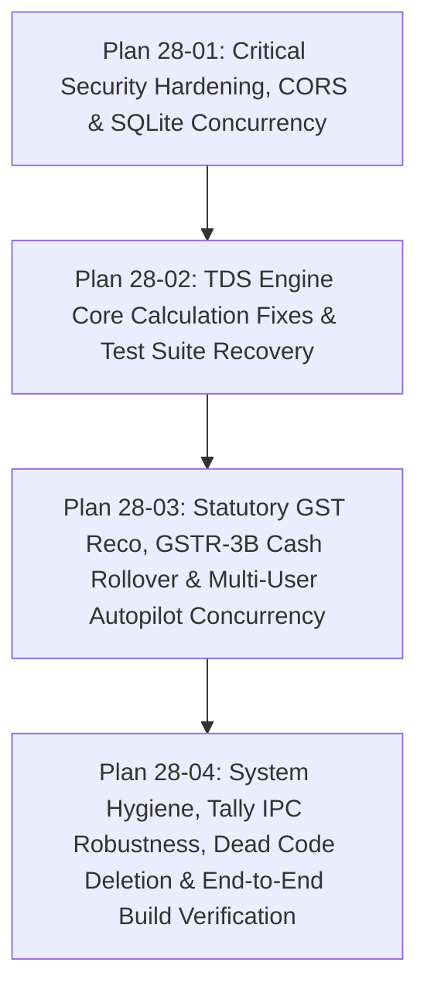

# Phase 28 Context: System Hardening, Security Safeguards & Comprehensive Bug Resolution

**Phase:** 28 — System Hardening, Security Safeguards & Comprehensive Bug Resolution  
**Milestone:** Vaswani Return Enterprise (Audit With Vaswani)  
**Status:** In Planning  

---

## 1. Locked Decisions & Architectural Contracts

### D-28-01: Principle of Least Privilege for GST Credentials
- **Decision:** Client portal passwords must **never** be transmitted in cleartext via any read API. The database column `portal_password` is reserved strictly for local portal authentication within Playwright automation runners.
- **Contract:** Any API returning client lists (`/api/ims/credentials`, `/api/returns/clients-hub`, etc.) must project passwords as a boolean flag `hasCredentials` or `has_password`. Direct updates (`/api/ims/credentials/update`) require valid session authentication.

### D-28-02: Strict CORS Protection with Localhost and LAN Subnets
- **Decision:** Remove `origin: true` reflection from Express CORS middleware.
- **Contract:** Explicitly whitelist `http://localhost:8080`, `http://127.0.0.1:8080`, `http://localhost:3001`, `http://127.0.0.1:3001`, Electron `file://` scheme, and RFC 1918 private LAN ranges (`192.168.*`, `10.*`, `172.16-31.*`). Block all external internet domains.

### D-28-03: Zero-Shell-Injection Explorer Launcher
- **Decision:** Eliminate all usage of `child_process.exec` when launching local paths from user input.
- **Contract:** Use `spawn('explorer.exe', [targetFolder], { shell: false })` or Electron `shell.openPath()`. Paths must be sanitized and verified with `fs.existsSync`.

### D-28-04: High-Concurrency SQLite Configuration
- **Decision:** Configure SQLite for concurrent LAN read/write performance.
- **Contract:** On database initialization, immediately execute:
  - `PRAGMA journal_mode = WAL;`
  - `PRAGMA busy_timeout = 10000;`
  - `PRAGMA synchronous = NORMAL;`

### D-28-05: 100% Green Vitest Test Suite Guarantee
- **Decision:** All 41 test files in the project must pass with 0 failures before Phase 28 is deemed complete.
- **Contract:** The 4 failing test cases in `src/test/tdsEngine.test.ts` must pass without altering test expectations.

### D-28-06: Strict Zero-Merge Export Invariant Preservation
- **Decision:** All fixes must preserve the zero-merge architecture across spreadsheet exports (`ws['!merges'] = []`).

---

## 2. Plan Breakdown & Dependency Graph

- **Plan 28-01:** Hardens network entry points (CORS, credentials endpoint, Explorer launcher, SQLite WAL, path traversal guards).
- **Plan 28-02:** Fixes core calculation bugs in `src/lib/tdsEngine.ts` (duplicates, confirmed matches, group keys) and recovers 100% Vitest pass rate.
- **Plan 28-03:** Resolves browser singleton collisions in GSTR-1 and GSTR-2B autopilot, fixes tax head classification in reconciliation engine, and implements cash credit carry-forward in GSTR-3B.
- **Plan 28-04:** Eliminates dead files, validates Tally IPC payload, polyfills AbortSignal in testing, and executes full production build verification.
